上周休年假，在网上找了一个山西仿古旅行团，一个人报名体验了一番，学到了很多古建知识。

这趟行程的实际路线是：**五台**（南禅寺 → 佛光寺 → 塔院寺 → 显通寺 → 罗睺寺）→ **浑源**（悬空寺）→ **大同**（云冈石窟 → 九龙壁 → 善化寺 → 华严寺）→ **应县**（净土寺 → 木塔）→ **朔州**（崇福寺）→ **太原**（晋祠 → 山西博物院）。

<!--more-->

这条线叫"**重走梁林路**"，大概是1933到1937年，梁思成、林徽因与营造学社同仁四赴山西，从大同的辽金木构一路测到五台的唐构，最终在1937年7月5日于佛光寺东大殿读出"唐大中十一年"的墨迹，推翻了日本学者"中国境内已无唐代木构"的断言。它本质上是一条**中国木构建筑的年代剖面线**。

这条路线在年代上，从北魏云冈（460—524）一路排到明洪武年的九龙壁（1392），跨度约九百三十年，中间没有一个朝代缺席。

---
## 第一站：五台（台外唐构到台怀诸寺）

中国现存三座唐代木构，全部在山西，且全部是**民间或地方性建筑，不是皇家工程**——这一点极重要：正因为它们"级别不高、地处偏僻"，才躲过了会昌法难与历代战火。

| 序号  | 建筑         | 位置          | 年代          | 国保批次     | 距今（2026） |
| --- | ---------- | ----------- | ----------- | -------- | -------- |
| ①   | **南禅寺大殿**  | 忻州五台县阳白乡李家庄 | 唐建中三年（782）  | 国一（1961） | 1244 年   |
| ②   | **广仁王庙正殿** | 运城芮城县龙泉村    | 唐大和五年（831）  | 国五（2001） | 1195 年   |
| ③   | **佛光寺东大殿** | 忻州五台县豆村镇佛光山 | 唐大中十一年（857） | 国一（1961） | 1169 年   |

> ⚠️ **注意年代顺序**：南禅寺（782）比佛光寺（857）早 75 年，是**中国现存最古老的木结构建筑**，也是亚洲现存最古老的木构之一。但"名气"在佛光寺——因为佛光寺是**官式高等级建筑**，体量大、形制完整、还带唐代题记、唐代彩塑、唐代壁画，是"能拿来当教科书"的那一座。

> **本线在五台看的是"两个层级"的唐构**：南禅寺（村庙）与佛光寺（官寺）。看完这两座，"唐代的尺度"就成了基准线——后面到辽金，斗拱一小、装饰一多、昂一假，你立刻能感觉出来。

> **站内动线**：南禅寺（台外，距台怀约 100 km）→ 佛光寺（台外，约 50 km）→ 回台怀，**塔院寺 → 显通寺 → 罗睺寺**（三寺紧邻，步行即可）。先跑远的，最后一段不折腾。

### 1.1 南禅寺

**唐建中三年（782）｜第一批全国重点文物保护单位**——中国现存最古老的木结构建筑，原是五台县阳白乡李家庄与郭家寨两村共用的村庙。

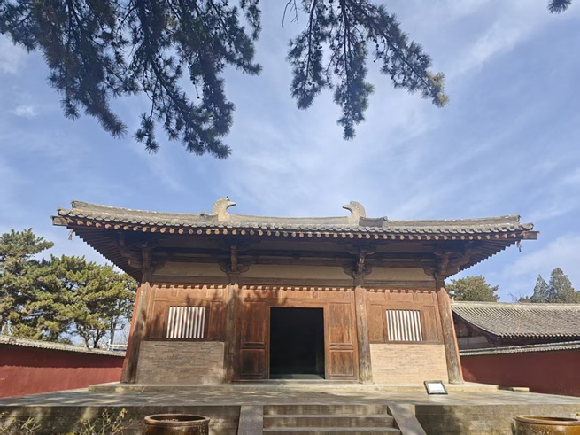

#### 形制与结构

- **单檐歇山顶 + 抬梁式**：屋顶重量全部由柱与梁架承担，墙只起围护作用，所谓"**墙倒屋不塌**"。这是判断抬梁式的最直观方法。

- **面阔进深各三间**：尺度接近民居，是唐代"村庙"级别的真实样貌。正因体量小、地处乡野，武宗会昌五年（845）灭佛时未被波及——**它比佛光寺躲得快**。

- **斗拱**：用材硕大，与柱高比例远大于后世；这是唐代建筑的共同指纹（"斗拱硕大、出檐深远、举折平缓"）。

#### 必看细节

1. **鸱吻（屋脊两端的兽头）**

   这对鸱吻是**依据渤海国上京龙泉府遗址出土的唐代鸱吻复原**的——渤海国是唐的藩属（群资料写"番薯"，应为"藩属"），地在今东北与俄罗斯远东一带，后为契丹所灭。也就是说，**这是"地道的唐代原创形制"，但原件不是唐代原物**，看的时候心里要有这个区分。

2. **殿内 14 尊唐代彩塑**

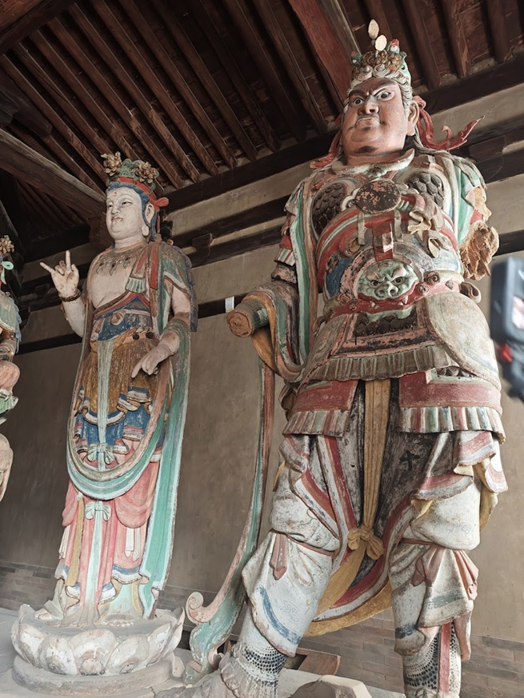

   - 原有 **17 尊**；1999 年 11 月 24 日晚约 7 时被盗 3 尊，主尊佛像被"开膛破肚"（盗取内藏），此案**迄今未破**。

   - 现存 14 尊，是除敦煌外中国最重要的唐代彩塑群之一。

   - 全国现存唐代彩塑约 **82 尊**——这个数字要记住，它解释了为什么每一尊都金贵。

3. **梁架题记**：殿内梁下有墨书题记，是判定建中三年（782）的关键证据，也是"唐构"身份的证据链。

4. **平梁与叉手**：唐构里常见的人字形叉手（斜撑），是唐代梁架的重要特征，与后世的金柱、蜀柱体系不同。

#### 总结

南禅寺的可贵不在体量，在标本性。它是中国现存最古老的木结构建筑，也是三座唐构里唯一一座**村庙**——原本只是李家庄与郭家寨两村共用的小庙，面阔进深各三间，尺度接近民居，抬梁式构架配单檐歇山顶，斗拱用材硕大、出檐深远、屋脊平缓，唐人的做法一眼可辨。正因为级别低、地处五台县阳白的乡野，会昌五年灭佛时它没被列入清理名单，此后一千二百多年也没被"重修升级"过，于是原样留到了今天。殿内 14 尊唐代彩塑（原有 17 尊，1999 年 11 月盗失 3 尊、主尊被开膛，案件至今未破）与梁下"唐建中三年"墨书题记，是判定它身份的两条硬证；全国现存唐代彩塑不过八十余尊，这 14 尊的分量由此可知。屋顶那对鸱吻要分清：形制是依渤海国上京龙泉府遗址出土的唐鸱吻复原的，地道唐样，但物件不是唐代原物。看南禅寺，看的其实是"唐代一个普通村子能盖出什么样的房子"。

### 1.2 佛光寺东大殿

**唐大中十一年（857）｜第一批国保**——唐代官式建筑里唯一"四绝齐全"的幸存者，梁思成称其为"中国第一国宝"。

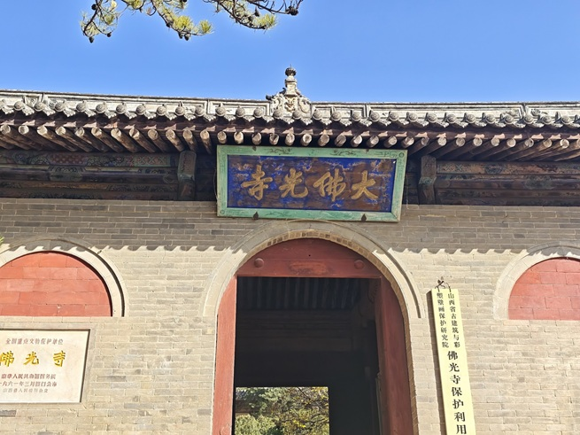

#### "佛光寺四绝"：建筑、彩塑、壁画、题记

这四样同时在东大殿里凑齐，全国仅此一处。下面按四绝拆开讲。

##### ① 建筑：唐代官式建筑的标准答案

- **单檐庑殿顶**：屋顶等级最高的一档（庑殿 > 歇山 > 悬山 > 硬山）。

- **面阔七间、进深四间**：体量在唐构中属大型。

- **殿堂式结构**：内柱与檐柱**等高**，柱头之上叠斗拱承托屋顶，结构层次复杂、规格高。

- **出檐 3.96 米**：这是唐代"出檐深远"的量化证据——近 4 米的屋檐，靠的是硕大斗拱层层出跳。

- **柱头铺作：四跳七铺作双杪双下昂**。理论上八铺作是最高等级，但**现存古建中尚未发现八铺作实例**，所以七铺作就是"能看到的顶配"。

- **举折平缓**：屋面曲线比明清平缓得多，屋脊到檐口的落差小，视觉上舒展、有唐人的从容。

##### ② 彩塑：35 尊里的 34 尊唐塑

- 殿内共 **35 尊**彩塑：除**韦陀像为明代**补塑外，其余 **34 尊均为唐代原塑**。

- 唐代风格辨识点：**体态丰满、服饰简洁、衣纹利落流畅**，不作繁复装饰，气韵内敛。

- 佛像最后一次补色在 **1933 年**；辛亥革命后曾为佛像披龙袍，梁思成在《记五台山佛光寺建筑》中直斥其"**媚俗**"。这句话可以记下来——它代表了中国早期建筑史学者的审美立场：**反对用后世的俗艳去覆盖唐代的克制**。

- 沿大殿一周原为**明代 500 罗汉彩塑**，因大殿后山墙坍塌损毁，现仅存 **297 尊**（296 尊罗汉 + 1 尊愿诚和尚塑像）。愿诚和尚是主持重建东大殿的唐代僧人，把他塑进罗汉群，是"人入神列"的做法。

##### ③ 壁画：三层叠压的时间

| 位置               | 年代                          | 说明                                                  |
| ---------------- | --------------------------- | --------------------------------------------------- |
| 拱眼壁（斗拱之间的"由额"上方） | **北宋宣和年间**（群资料写"崇和"，应为"宣和"） | 佛教故事画，宋代重修时补绘                                       |
| 阿弥陀佛座后           | 推测**唐代**                    | 高约 30 厘米、长约 80 厘米的小型壁画，被佛像遮挡，常人看不到，是 2010 年代勘察的重要发现 |
| 内槽棋眼及栱腹          | 唐—宋                         | 部分为唐代原作                                             |

> **看法**：佛光寺的壁画不在"大"，而在"层"——同一面墙上有唐、宋两代的手笔，这是木构建筑"不断被修、不断被叠"的活标本。

##### ④ 题记：改变中国建筑史的四行墨迹

- **大殿内四根四椽栿（四椽袱）上方均有题记**。

- 北侧四椽栿上写："**功德主故右军中尉王，佛殿主上都送供女弟子宁公遇**"（群资料"右军中蔚王"，"蔚"应为"尉"）。

- 与殿外**唐大中十一年经幢**上的"女弟子宁公遇"记载完全吻合——**梁架题记 + 经幢 + 造像风格**，三重证据锁死年代。

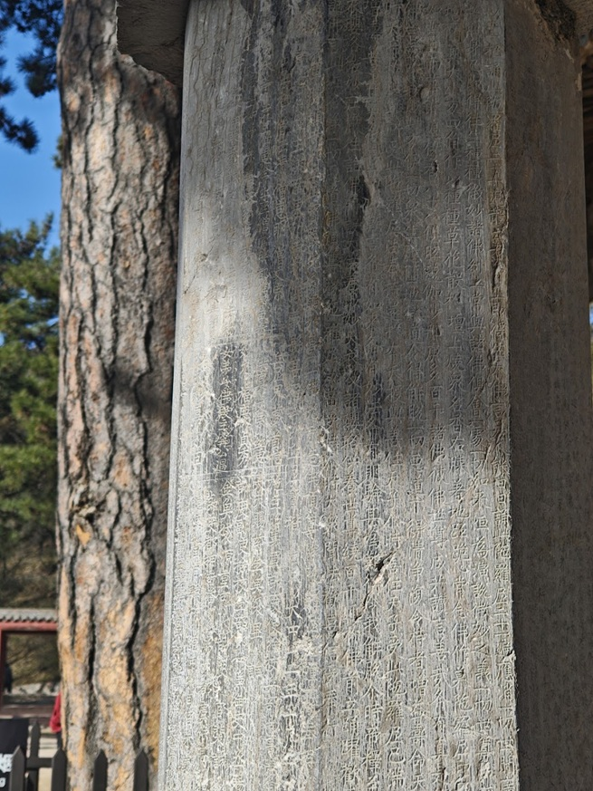

**1937 年 7 月 5 日**，梁思成、林徽因第四次入晋，在佛光寺读出这行墨迹，证实东大殿建于唐大中十一年（857），**打破了日本学者关野贞、常盘大定"中国境内已无唐代木构，要看唐代建筑只能去日本奈良"的定论**。这一天在中国建筑史上，份量等同于一次考古大发现。

- **板门题记**：1964 年 7 月，罗哲文先生考察时在板门背后发现大量题记，其中最早为**唐咸通七年（867）**，仅比大殿始建晚 9 年。据此推断：**东大殿现存板门是唐代始建时的原物**——这意味着你手边那两扇门，是 1169 年前的木头。

##### ⑤ 地基

- **东面为天然地基**，**西面为北魏时期的夯土地基**——同一座殿，两种基础，说明建殿时借用了北魏旧寺的基址。

- 2017 年，东侧靠近山墙的天然地基下陷，导致大面积漏雨，屋顶部分结构受损严重。这也是今天东大殿部分区域限流、禁止登临的原因之一。

#### 文殊殿（金代）

- **金代建筑**，面阔七间、进深四间。

- 殿内墙壁有**明初 500 罗汉壁画**，实存 **245 尊**。

- 佛坛上七尊塑像，正中为"**新样文殊**"，具金代塑像风格，是**中国现存最早的文殊七尊像**。

- **减柱法**：梁架采用减柱造，用**八字托架**把屋顶重量分散到柱子上，殿内因而空旷。

- **额枋长度达 14 米**——单根额枋做到 14 米，在现存古建中相当罕见（木材长度是硬约束）。

> 文殊殿常被游客匆匆略过，其实它是**金代"减柱 + 大额枋"技术路线的最佳标本**，比东大殿更能看出"后世怎么在唐构基础上做减法"。

#### 总结

佛光寺东大殿是这条线上唯一的唐代官式高等级建筑：单檐庑殿顶，面阔七间、进深四间，殿堂式构架，内柱与檐柱等高，柱头叠七铺作双杪双下昂，出檐 3.96 米，屋面举折平缓——唐人的气度是结构撑起来的，不是装饰堆出来的。它无可替代之处在于"四绝同堂"：建筑本身、34 尊唐塑（第 35 尊韦陀为明塑）、北宋宣和年间拱眼壁壁画，以及写在四根四椽栿上的墨迹"功德主故右军中尉王，佛殿主上都送供女弟子宁公遇"。1937 年 7 月 5 日梁思成、林徽因读出这行字，与殿外唐大中十一年经幢互证，一举推翻日本学者"中国已无唐代木构、要看唐建只能去奈良"的断言；1964 年罗哲文又在板门背后发现唐咸通七年题记，仅晚于建殿九年，据此认定现存板门仍是唐代原物——你手边那两扇门，是 1169 年前的木头。地基也藏着层信息：东面天然地基、西面北魏夯土地基，说明建殿时借了旧寺基址；2017 年东侧下陷漏雨，屋顶受损，这也是部分区域限流的原因。台外这一趟不轻松，但它是整条线的地基：没有它作基准，到大同你就感觉不出辽金的"变小变繁"。旁边的文殊殿也值得留二十分钟——金代减柱造、八字托架、14 米整根额枋，还有中国现存最早的文殊七尊像。

### 1.3 五台山总说

**中国四大佛教名山之首、文殊菩萨道场**，2009 年以"文化景观"列入世界遗产。台怀镇是核心，五个台顶是另一套体系。

#### 四大佛教名山（对照表）

| 名山  | 省份  | 菩萨           | 道场核心        |
| --- | --- | ------------ | ----------- |
| 五台山 | 山西  | **文殊菩萨**（大智） | 台怀镇诸寺 + 五台顶 |
| 普陀山 | 浙江  | 观音菩萨（大悲）     | 普济寺、不肯去观音院  |
| 峨眉山 | 四川  | 普贤菩萨（大行）     | 金顶、万年寺      |
| 九华山 | 安徽  | 地藏菩萨（大愿）     | 化城寺、肉身殿     |

#### 世界五大佛教圣地

1. **蓝毗尼花园**（尼泊尔）——佛陀诞生地

2. **鹿野苑**（印度）——佛陀初转法轮、初次讲经说法地

3. **菩提伽耶**（印度）——佛陀悟道成佛地

4. **拘尸那迦**（印度）——佛陀涅槃地

5. **山西五台山**——文殊菩萨道场

> 前四个是"佛陀一生的四个坐标"，第五个是**唯一以菩萨道场身份入选的**。这就是五台山在佛教地理中的特殊位置。

#### 五个台顶（朝台必备表）

| 方位     | 台名      | 海拔           | 寺院  | 供奉    | 备注               |
| ------ | ------- | ------------ | --- | ----- | ---------------- |
| 东台     | 望海峰     | 约 2795 m     | 望海寺 | 聪明文殊  | 观日出最佳            |
| 南台     | 锦绣峰     | 约 2485 m     | 普济寺 | 智慧文殊  | 夏季花草最盛           |
| 西台     | 挂月峰     | 约 2773 m     | 法雷寺 | 狮子吼文殊 | 赏月               |
| **北台** | **叶斗峰** | **3061.1 m** | 灵应寺 | 无垢文殊  | **华北最高峰，"华北屋脊"** |
| 中台     | 翠岩峰     | 约 2894 m     | 演教寺 | 孺童文殊  | 台顶最平阔            |

> **"大朝台"** 指徒步或乘车走遍五个台顶，需一整天、体力与好天气，**汛期与冬季可能临时管控**。"**小朝台**"指登黛螺顶（1080 级"大智路"），一殿之内拜五方文殊，是时间不够时的替代方案。

#### 总结

五台山在佛教地理里的位置很特殊：文殊菩萨道场，中国四大佛教名山之首，也是"世界五大佛教圣地"里唯一以菩萨道场、而非佛陀行迹入选的一处（另四地为蓝毗尼、鹿野苑、菩提伽耶、拘尸那迦）。它的"最早"是实的——东汉永平十一年（68）建大孚灵鹫寺，即今显通寺，是中国第一座真正具有佛教性质的寺院；"最多"也是实的——唐代鼎盛时寺院三百六十余处，现存 124 座，仍居四大名山之首；2009 年以"文化景观"列入世界遗产。台怀核心是一圈青庙与黄庙并存的寺院群，心里要有一条线：显通寺是"原点"，塔院寺是"地标"，罗睺寺是"转折"——汉传与藏传在同一座院落里完成了交接。五个台顶是另一套体系：东台望海峰望海寺供聪明文殊、南台锦绣峰普济寺供智慧文殊、西台挂月峰法雷寺供狮子吼文殊、北台叶斗峰灵应寺供无垢文殊（3061.1 米，华北最高，故称华北屋脊）、中台翠岩峰演教寺供孺童文殊。时间不够就走黛螺顶"小朝台"，一殿之内拜全五方文殊；体力与天气都许可，才谈得上"大朝台"。

### 1.4 塔院寺

**第二批国保**，原为显通寺的塔院，明永乐五年（1407）独立成寺——整座寺院是围绕一座白塔长出来的。

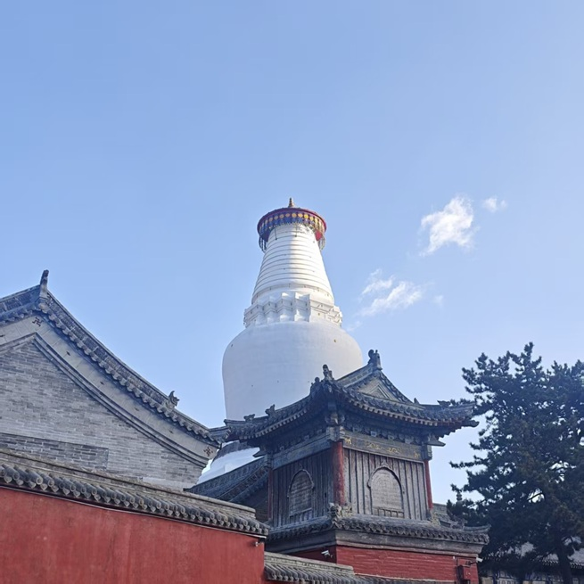

#### 逐殿细看

**① 山门**

- 左右四大天王，中间**观音菩萨与韦陀菩萨**并列。

- 这个形制**比较特殊**：一般寺院山门（天王殿）以弥勒居中、韦陀背立，塔院寺把观音请到正面，是它作为"塔院"独立后的自我定位。

**② 大慈延寿宝殿**

- 为祈福**慈圣皇太后李娘娘**（明万历生母）而建——所以殿名带"延寿"。

- 正中佛龛供释迦牟尼，两侧文殊、普贤，合称"**华严三圣**"。

- **黑文殊**：这尊文殊**黑胡黑须**，塑像特殊，人称"黑文殊"。汉地文殊造像多作女相或童子相，留须者极少，值得特别看一眼。

**③ 大白塔（释迦牟尼舍利塔）**

- 通高 **75.3 米**，环周 **83.3 米**。

- 塔身洁白，**状如藻瓶**（覆钵式），造型优美。

- 塔顶**铜板按八卦方位安置**，悬挂 **252 个风铃**，风吹铃动。

- 建于**元大德六年（1302）**，由**尼泊尔匠师阿尼哥**设计建造。

> 阿尼哥（Araniko）是元代最重要的外来匠师，北京妙应寺白塔也出自他的手笔。所以五台山大白塔与北京白塔是"同胞兄弟"——**尼婆罗（尼泊尔）式覆钵塔**在汉地的两个标准样本。

- 传说塔下藏有**释迦牟尼真身舍利**。

#### 总结

塔院寺原是显通寺的塔院，明永乐五年（1407）独立成寺，整座寺院是围绕一座塔长出来的。大白塔全称释迦牟尼舍利塔，通高 75.3 米、环周 83.3 米，覆钵式塔身状如藻瓶，塔顶铜板按八卦方位安置，悬 252 个风铃；元大德六年（1302）由尼泊尔匠师阿尼哥设计建造——北京妙应寺白塔同出他手，两座塔是尼婆罗式覆钵塔在汉地的同胞样本。殿宇部分有两处别处少见：山门以观音居中、韦陀并列，不合天王殿的常规格局；大慈延寿宝殿为明万历生母慈圣皇太后李氏祈福而建，殿中那尊留黑胡黑须的文殊，人称"黑文殊"，汉地文殊多作女相或童子相，带须者极少。大白塔定的是五台山的天际线，把它放在台怀三寺第一站是合适的——先看见那座塔，再看塔属于哪座寺。

### 1.5 显通寺

**第二批国保**，五台山的开山祖寺：东汉永平十一年（68）建，初名大孚灵鹫寺，历史最早、规模最大。

#### 逐殿细看

**① 钟楼**

- 上悬明代铸造铜钟，重 **9999.5 斤**。

- 传说为避明万历皇帝之"**万**"字讳，故意少铸半斤，取"万不到头"——这是**讲解口径**，属民间附会，但很有意思，可以当故事听。

**② 观音殿**

- 内供"**三大士**"：正中观音菩萨，左文殊、右普贤。

- 上悬"**霞表天城**"匾，**清乾隆皇帝御笔**。

- **不肯去观音的源头就在这**：唐代日本僧人**慧锷**（群资料写"慧颚"，应为慧锷）从此殿请走一尊二尺高玉雕观音，欲带回日本，船至舟山群岛受阻，遂悟"观音不愿东渡"，就地供奉，建"**不肯去观音院**"——**普陀山因此成为观音道场**。

> 一段"请佛未成"，改写了中国佛教四大名山的格局。这是五台山与普陀山之间最漂亮的一条历史线索。

**③ 大文殊殿（方便朝台）**

- 同时供奉**东、南、西、北、中五方文殊**与文殊师利本尊像。

- 因一殿即可拜全五台，故称"**方便朝台**"。

**④ 大雄宝殿**

- **纯木结构**，明代**重檐庑殿顶**——注意：这是五台山等级最高的殿顶。

- 全殿设 **108 根柱子**，象征人间 108 种烦恼。

- 内供"**三世佛**"：正中释迦牟尼，左右药师佛、阿弥陀佛。

> 严格说，"药师—释迦—弥陀"是**横三世佛**（按空间/世界分：东方净琉璃、娑婆、西方极乐），与"竖三世佛"（过去燃灯、现在释迦、未来弥勒）不同，看的时候可以留意一下匾额与方位。

**⑤ 普光明殿（无梁殿 / 无量殿 / 七处九会殿）**

- **纯砖石垒砌**，无一根木梁，故称"无梁殿"；谐音又称"无量殿"。

- 明代**憨山大师**设计修建。

- 内供**卢舍那佛**，旁有**十三层八角形多宝佛木塔**，高约 8 米，明代珍品。

**⑥ 千钵文殊殿**

- 内供铜铸文殊：**五头十三面、千手千钵千释迦**文殊，同为憨山大师设计铸造。

- "千钵"意为每钵中各现一释迦，是华严"一即一切"的图像化表达。

**⑦ 铜殿**

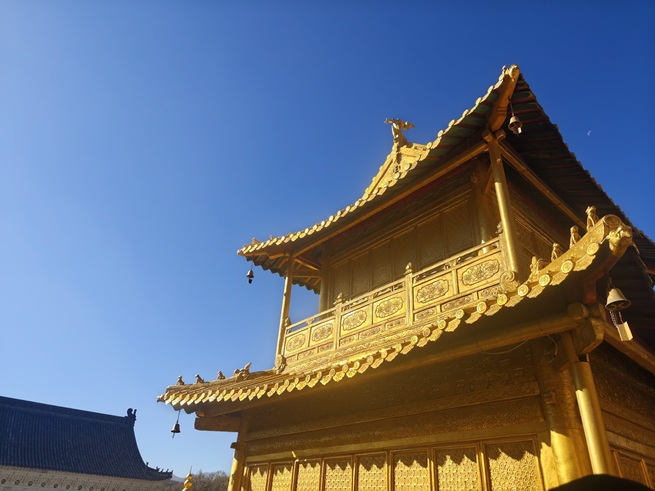

- **重檐歇山顶，外观两层、实为一层**，纯铜铸造。

- 内供佛像**一万尊**。

- 明代**妙峰法师**走遍一万户人家，化缘得铜十万斤，铸三座铜殿：

  - 五台山显通寺铜殿（现存）

  - 峨眉山金顶铜殿（**已重修**）

  - 南京宝华山铜殿（**已毁**）

> 所以这一座是**三座中的唯一原构**。

**⑧ 后高殿（藏经阁）**

- 内供**甘露文殊**与十八罗汉。

#### 总结

显通寺是五台山的原点：东汉永平十一年（68）建，初名大孚灵鹫寺，历史最早、规模最大，第二批国保。它最值得看的是"三种材料、三座代表作"——大雄宝殿纯木构，明代重檐庑殿顶，殿内 108 根柱子对应人间 108 种烦恼，供横三世佛；普光明殿又名无梁殿、无量殿，纯砖石垒砌不用一根木梁，内有明代十三层八角多宝佛木塔，高约 8 米；铜殿纯铜铸造，重檐歇山顶，外观两层实为一层，内供万尊佛像，是明代妙峰法师化缘十万斤铜所铸三座铜殿中唯一存原构的一座（峨眉山金顶已重修，南京宝华山已毁）。还有两条线索值得记住：钟楼那口明代铜钟重 9999.5 斤，传说为避万历"万"字讳少铸半斤——属民间附会，但好听；观音殿则是"不肯去观音"的起点，唐代日本僧人慧锷从此殿请走一尊玉雕观音，舟山受阻，悟观音不愿东渡，就地供奉，普陀山因此成为观音道场。一座殿串起五台山与普陀山，这条线是整站里最漂亮的。

### 1.6 罗睺寺（黄教格鲁派）

唐代只是大华严寺十二院之一的善住阁院，明弘治五年（1492）重建，清代由青庙改黄庙——一座院子叠了三层时间。

#### 逐殿细看

**① 天王殿（第一重殿）**

- 内塑**四大天王**。

- 殿前一对**唐代石狮**——五台山地区罕见的珍品，看石狮的蹲姿与鬃毛处理，是唐狮的典型样式。

**② 文殊殿**

- **单檐歇山顶，四出廊**。

- 内供文殊骑狮像：文殊面部**乳白色**，两肩伸出**肩花**，花上分置**经书**与**智慧剑**——这是**黄教文殊造像**的典型特征（青庙文殊多持如意，黄教则经、剑并持，象征般若与智慧之力）。

- 坐骑**绿毛狮子狻猊**，牵狮人**扶林**（一说为"佛陀波利"系统的于阗王形象），左为**善财童子**，右为**于阗王**。

- 殿后墙两角供**宗喀巴大师**像（黄教教主）。

**③ 大佛殿（第三进）**

- **重檐歇山顶**，面阔五间 16 米、进深 16.3 米，**前置抱厦**；殿前两通**康熙御碑**。

- 内供"**三世佛**"：释迦牟尼、药师佛、阿弥陀佛。

- 佛前另有三尊**戴尖帽**的像：正中**宗喀巴大师**，两侧**一世达赖**、**一世班禅**。

> 顶尖帽 = 格鲁派标志（黄帽派）。看到尖帽，就知道这是黄庙的排布逻辑。

**④ 藏经阁**

- **上层**：藏经阁。传说佛子罗睺罗曾在此显迹，其化身形成的**肉身菩萨舍利**供奉在二楼。

- **下层**： **"开花现佛"** ——

  - 殿内正中砌正方形高台，台上有**木质圆盘**，盘面刻水浪图案；

  - 圆盘正中装一朵**高达丈余的莲花**，由**八片莲瓣**合围；

  - 莲瓣内端坐**四尊佛像**；

  - **经人操纵机关，莲瓣可开可合**，开则现佛。

> 这是五台山最有"机关感"的一处，也是清代寺院把**机械装置**用于宗教叙事的绝佳案例。看的时候注意转盘下方的传动结构。

#### 总结

罗睺寺是"青庙改黄庙"的活标本。唐代它只是大华严寺（今显通寺）十二院之一的善住阁院，明弘治五年（1492）重建，明万历年间李彦妃为祈子拨款重修，清代改为格鲁派寺院（改宗年代有康熙、乾隆两说），寺名得于释迦牟尼十大弟子之一罗睺罗，密行第一。造像系统是黄教的：文殊殿的文殊面作乳白色，两肩伸出肩花，花上分置经书与智慧剑——青庙文殊多持如意，黄教则经、剑并持，象征般若与智慧之力；坐骑绿毛狮子狻猊，牵狮人扶林，左善财童子、右于阗王，殿后两角供宗喀巴。大佛殿三世佛前另有三尊戴尖帽的像，正中宗喀巴，两侧一世达赖、一世班禅——看到尖帽就知道是黄庙的排布逻辑。全场最有趣的是藏经阁下层的"开花现佛"：方形高台上置木圆盘，盘面刻水浪，正中一朵丈余高的莲花由八片莲瓣合围，瓣内端坐四尊佛像，靠机关操纵开合。这是清代寺院把机械装置用于宗教叙事的绝佳案例，值得弯腰看一眼转盘下方的传动结构。

---

## 第二站：浑源（悬空寺）

从台怀出山，向北经砂河、大营，进恒山**金龙峡**。

这是整条线上唯一"**建筑与山体长在一起**"的一处——前面看的是"房子怎么盖起来"，这里看的是"房子怎么挂上去"。悬空寺的真正看点不在险，在**力学**：半插飞梁、暗托岩石、膨胀螺栓原理，还有上方那把天然的岩石伞。

### 2.1 悬空寺

**北魏太和年间｜第二批国保**——建在恒山翠屏峰半山腰的儒释道三教合一寺院，看着悬空，其实不悬。

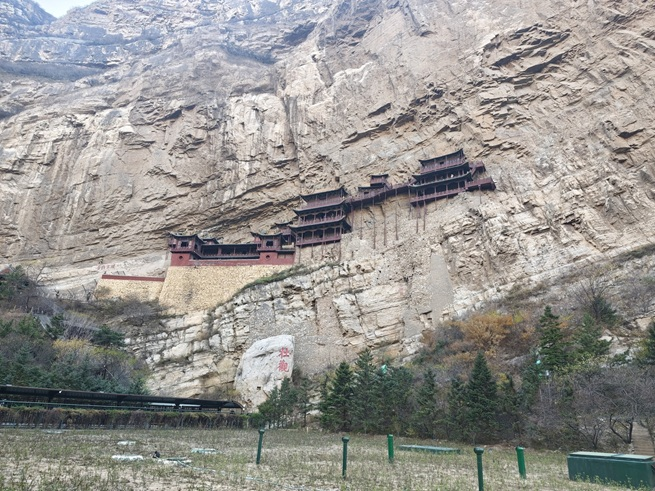

#### 为什么要修这座寺？

**背景：北魏太武帝拓跋焘灭佛。**

佛教寺院不纳税、僧人不服兵役，直接冲击国家财政与兵源，加上寺院形成独立政治力量、儒道与佛教的思想斗争、太武帝本人倾向道教并谋求与汉族士大夫合作——四重原因叠加，遂有 **"三武一宗"法难中的第一武**（太武帝）。

**转折：孝文帝拓跋宏。**

孝文帝遵循道长**寇谦之**遗训："要建一座空中寺院，以达'**上延霄客，下绝嚣浮**'"——上接天上仙人，下断人间喧嚣。悬空寺因此而生。

> 所以悬空寺的诞生逻辑不是"炫技"，而是**政治与信仰的转向纪念碑**：一个皇帝灭佛、另一个皇帝用一座悬在崖上的寺，把宗教重新安放到"离天更近、离人间更远"的位置。

#### 1500 年前怎么把它挂上去的？

核心原理八个字： **"半插飞梁为基，巧借岩石暗托"**。

1. **主体建筑每层都落在岩石上**，梁尾插入岩体，靠岩石本体承托，不是"吊"在空中。

2. **凿洞插梁**：在岩壁上凿**口小肚大**的洞，横梁插入后，内部用木楔撑开——**原理类似膨胀螺栓**，越受力越咬得紧。

3. **栈道连接**：三部分建筑之间用横梁挑出的栈道相连，形成整体。

> **结论：悬空寺并不悬空。** 它是**嵌入式锚固结构**，不是悬索结构。这一句是可以直接拿去纠正朋友圈谣言的。

#### 为什么能活 1500 年？

| 原因         | 具体机制                                                                  |
| ---------- | --------------------------------------------------------------------- |
| ① **结构合理** | 半插飞梁 + 岩石暗托，受力路径清晰                                                    |
| ② **选址巧妙** | 背倚翠屏峰，处**石崖向内凹进处**；上方凸出的岩体像一把伞，遮挡大部分雨水，避免木材腐烂；高位避洪水；四周山峦缩短日照时间，减缓木材老化 |
| ③ **材料优质** | 全部木构件用**恒山特产铁杉木**，纹理细密、抗弯强度高；木料**桐油浸泡**，防腐、防虫、防水，甚至抗白蚁                |
| ④ **人的维护** | 当地百姓自发保护 + 历代修缮                                                       |

> 把这四条并排看，会发现一个规律：**中国木构的长寿，通常不是单点奇迹，而是"结构 + 选址 + 材料 + 人力"四件事同时做到的結果**。应县木塔、佛光寺、南禅寺，用的都是这同一套逻辑。

#### 布局：三部分

- **南侧第一部分（二层）**

  - 一层：**禅房**

  - 二层：**大雄宝殿**

  - **脱纱工艺**：殿内三尊佛像采用"脱纱（夹纻）"工艺，**每尊仅一公斤多**，为大殿极大减负。这是塑像工艺与结构力学的结合——**为了不给悬崖加重量，连佛像都要"减肥"**。

- **中部与北侧（各三层楼阁）**

  - 中间以**悬空栈道**连接；

  - 设**雷音殿、三佛殿、三官殿**等；

  - **北侧最高处是三教殿**：同时供奉**释迦牟尼（佛）、老子（道）、孔子（儒）**——"**三教合一**"的实体表达。

#### 那 30 根柱子到底受不受力？

民谚："**悬空寺，半山高，三根马尾空中吊**。"

- 远看像很多碗口粗的柱子撑起整座建筑，实际这 **30 根细长木柱基本不受力**，甚至**可以用手晃动**。

- 两种解释并存，都值得记：

  1. **保险论**：平时不受力，一旦主体结构变形，可起"**一柱顶千斤**"的应急支撑作用；

  2. **监测论**（更有意思）：这些柱子原是**竹竿**，用来监测——一旦建筑整体承重失衡，柱子会弯曲，起到**警示**作用，相当于古代的"应变计"。

> 第二种说法在学界并非定论，但它精准点出了中国古建的一种智慧：**把安全预警做进构件本身**。

#### 名人到访

- **李白**：写下"**壮观**"二字（今寺下岩壁刻石，"壮"字多一点，传为李白醉后所书）。**注意**：题字真伪学界有争议，作民间说法讲述即可。李白"**危楼高百尺，手可摘星辰。不敢高声语，恐惊天上人**"（《夜宿山寺》）写的正是这类空中楼阁的气象。

- **徐霞客**：明代大旅行家，盛赞其为"**天下巨观**"。

#### 总结

悬空寺的看点是力学，不是险。它始建于北魏太和年间，儒释道三教合一，平面仅 125 平方米、建筑面积 258 平方米、阁楼四十余间，属袖珍寺庙；原距地面九十余米，因金龙峡河床堆积、地基抬高，今约六十米。核心做法八个字："半插飞梁为基，巧借岩石暗托"——主体建筑每层都落在岩石上，横梁插入口小肚大的岩洞，内部以木楔撑开，原理类似膨胀螺栓，越受力咬得越紧。所以**它并不悬空**，这是嵌入式锚固，不是悬索结构。能活一千五百年，靠四件事同时成立：结构合理；选址巧妙（背倚翠屏峰、处于崖壁内凹处，上方凸岩如伞遮雨，高位避洪水，四周山峦缩短日照）；材料优质（恒山铁杉木经桐油浸泡，防腐防虫防水）；历代百姓自发维护。布局三段：南段二层为禅房与大雄宝殿，殿内三尊脱纱佛像每尊仅一公斤多，是为悬崖减负；中段与北段各三层，以悬空栈道相连，最高处三教殿同奉释迦牟尼、老子、孔子。寺下那 30 根碗口粗的柱子基本不受力、可用手晃动，两种解释并存——保险论说它"一柱顶千斤"，监测论说它原是竹竿、弯曲即预警；后者虽非定论，却点出了中国古建把安全预警做进构件本身的智慧。李白"壮观"二字真伪学界有争议，徐霞客"天下巨观"则是确凿的。

---

## 第三站：大同（云冈到华严寺）

大同在辽代为"**西京**"，金代沿袭。所以城内的华严寺、善化寺都是**辽金皇家/官式级别**，与五台山的民间寺院完全不是一个量级。

城内四处，顺序是 **云冈石窟（北魏石刻）→ 九龙壁（明代琉璃）→ 善化寺（辽金木构）→ 华严寺（辽金最大佛殿）**——一条"**石 → 琉璃 → 木**"的材料线，也是一条"从北魏走到金代"的时间线。

### 3.1 云冈石窟

**北魏开凿｜第一批国保｜2001 年列入世界遗产**——东西绵延约一公里，现存窟龛 254 个、主要洞窟 45 座、造像 59000 余尊。

#### 修建背景：一部"灭佛—兴佛"的完整剧本

1. **佛教东汉传入**，先在民间信奉；

2. **五胡十六国**时期迅速发展；

3. **北魏**时期国家推崇，佛教上升为国教级力量；

4. **太武帝灭佛**（四大原因）：

   - **经济**：寺院经济膨胀，与中央集权的封建王朝经济利益冲突；

   - **政治**：拥有雄厚经济力量的寺院形成相当的政治力量，危及国家政权；

   - **思想**：儒、道文化与佛教思想的斗争；

   - **民族**：太武帝弃佛信道，谋求与汉族士大夫的合作。

5. **文成帝复兴佛法**，任命**沙门统昙曜**主持开凿云冈石窟。

> **"昙曜五窟"（16—20 窟）就是这次复兴的政治宣言**。《魏书·释老志》载文成帝"诏有司为石像，令如帝身"——五尊大佛被认为分别对应北魏五帝，**把皇权直接铸进山崖**。第 20 窟露天大佛（高约 13.7 米）是云冈的封面。

#### 石窟寺在中国的传播路线

```
古印度（石窟寺最早出现）
   ↓
犍陀罗地区（今巴基斯坦白沙瓦谷地）—— 佛像最早诞生地
   ↓
新疆 → 河西走廊 → 关陇
   ↓
5 世纪：云冈石窟开凿 → 达到鼎盛
   ↓
流布中华（龙门、麦积山、敦煌、大足……）
```

> 核心判断：**佛像不是"印度造像"直接搬来的，是在犍陀罗（希腊化佛教艺术）熔过一次，再沿河西走廊一站站汉化的**。云冈正是这条链上"汉化正在发生"的关键一站。

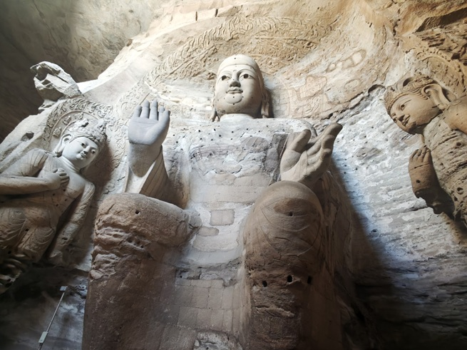

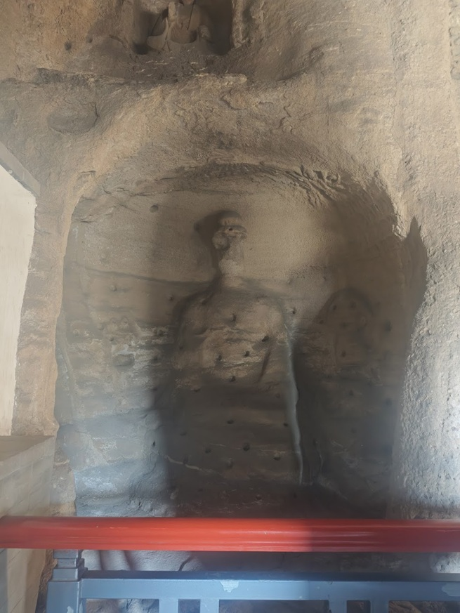

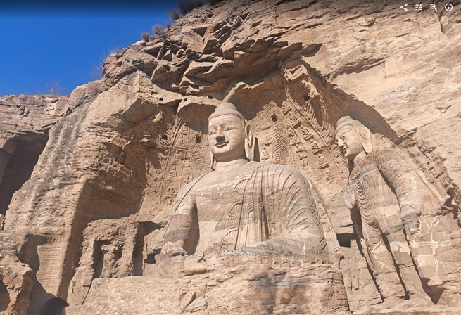

#### 云冈三期：一部可以"看出来"的风格演化史

##### 早期（460—465）｜代表 16—20 窟（昙曜五窟）

| 维度       | 特征                                                                 |
| -------- | ------------------------------------------------------------------ |
| **窟形**   | 平面呈**马蹄形**，顶部为**穹窿状**；每窟**一门一窗，窗在上、门在下**                           |
| **雕像**   | 各窟主尊为**三世佛**，主佛居中，身躯高大；**袈裟厚重、肉髻高耸、高鼻深目、眉眼细长、嘴角上翘、大耳垂肩**，身躯健硕，神情威严 |
| **风格**   | 造像**雄浑伟大、旷世无双**的气势                                                 |
| **宗教意义** | 体现"**佛法流传不息、世代长存**"的思想                                             |

> 关键词：**雄浑、外来、皇家**。这一期的佛像是"印度—中亚面孔 + 北魏体魄"。

##### 中期（465—494）｜代表 1、2 窟，5、6 窟，7、8 窟，9、10 窟，11、12、13 窟，及未完成的 3 窟

| 维度     | 特征                                                               |
| ------ | ---------------------------------------------------------------- |
| **窟形** | 除穹窿形（多在大像窟）外，出现**方形中心塔柱窟（支提窟）**与**前后室殿堂式洞窟（佛殿窟）**；**平面方形洞窟大量出现** |
| **雕像** | 部分佛像开始**清秀**，面相适中；佛衣除**右袒式、通肩式**袈裟外，出现"**褒衣博带**"样式               |
| **风格** | 雕刻面积大幅增加，内容与形式更丰富；佛龛造型多样，**窟顶多用平棋藻井**；佛、菩萨、飞天、金刚、伎乐天、供养天千姿百态     |

> 关键词：**繁丽、汉化开始**。"褒衣博带"是汉式士大夫衣冠，佛穿上它，就是佛教穿上中原的衣服。

> **第9—13窟俗称"五华洞"** ；**第 12 窟因乐器雕刻极丰富，被称为"音乐窟"**——这一窟值得单独留 20 分钟。

##### 晚期（494—524）｜代表 21—45 窟

| 维度     | 特征                                                 |
| ------ | -------------------------------------------------- |
| **窟形** | 中小型洞窟，类型复杂、式样多变；造像内容趋于**模式化、简单化**                  |
| **雕像** | 佛像一律**褒衣博带**，**面容消瘦、细颈削肩**，神情虚无飘渺；菩萨身材修长、帔帛交叉、表情孤傲 |
| **风格** | 汉化风格明显， **"秀骨清像"**                                  |

> 关键词：**清瘦、彻底汉化**。孝文帝迁都洛阳（494）后，云冈的皇家工程停摆，民间继续开凿，风格随之"南朝化"。

#### 云冈飞天三变（最直观的一条演化线）

| 阶段  | 代号             | 外貌                                               | 服饰与动态                                                          | 代表窟                |
| --- | -------------- | ------------------------------------------------ | -------------------------------------------------------------- | ------------------ |
| 一   | 西域"**壮汉**"风    | 身材健硕、体格粗短、肩宽胸厚，有明显男性特征（甚至腹肌）；脸型浑圆、高鼻深目，浓浓印度—中亚范儿 | **上身袒露**，斜披饰物，下身穿**紧身长裙**，赤足；飞行动作笨拙，靠四肢摆动与身体扭曲表现动感，**飘带尚不常见**  | **第 20 窟**大佛背光上的飞天 |
| 二   | 胡汉融合的"**舞蹈家**" | 身材匀称舒展，脸型仍圆润但线条更柔和                               | 开始穿中原式**褒衣博带**，**长飘带出现**，随身体舞动形成"**之**"字形或"**曲别针**"状的优美线条，动感极强 | **第 6、7、8 窟**      |
| 三   | 飘逸的"**中原仙女**"  | "**秀骨清像**"，纤细苗条、面容清秀，**完全女性化**，气质温婉              | 身着**宽袍大袖汉服**，长飘带几乎遮住双脚，完全依靠衣裙舞带在空中翱翔，**失去体量感**，更像剪影或剪纸，极具装饰性   | 西部诸窟，及早期洞窟中后期补刻的龛像 |

> **一句话串起来**：飞天的体重一路在减——从"有腹肌的壮汉"到"飘带遮脚的仙女"。**减掉的不是肉，是外来性。**

#### 总结

云冈是刻在石头上的汉化史。北魏太武帝灭佛之后，文成帝复兴佛法，任沙门统昙曜主持开凿，早期五窟（16—20 窟，460—465）马蹄形平面、穹窿顶、一门一窗，主尊三世佛身躯高大、袈裟厚重、高鼻深目，是"印度—中亚面孔 + 北魏体魄"；第 20 窟露天大佛高约 13.7 米，是云冈的封面。中期（465—494）出现方形中心塔柱窟与前后室佛殿窟，佛像转清秀，佛衣出现"褒衣博带"，窟顶多用平棋藻井，第 9—13 窟俗称五华洞、第 12 窟因乐器雕刻极丰称音乐窟。晚期（494—524）以中小窟为主，一律褒衣博带、面容消瘦、细颈削肩，即"秀骨清像"。飞天的三变最直观：从有腹肌、飘带罕见的西域壮汉，到褒衣博带、飘带成"之"字形或曲别针状的胡汉融合舞蹈家（第 6、7、8 窟），再到宽袍大袖、飘带遮脚、近乎剪影的中原仙女——体重一路在减，减掉的是外来性。往上追，这条线的源头是犍陀罗（今巴基斯坦白沙瓦谷地）的佛像诞生，经新疆、河西走廊、关陇东传，五世纪因云冈开凿而达到鼎盛，再流布中华。现存窟龛 254 个、主要洞窟 45 座、造像 59000 余尊。

### 3.2 九龙壁

**明洪武二十五年（1392）｜第五批国保**——代王朱桂府邸的照壁，府邸毁于兵火而壁独存，1954 年依原状南移 28 米。

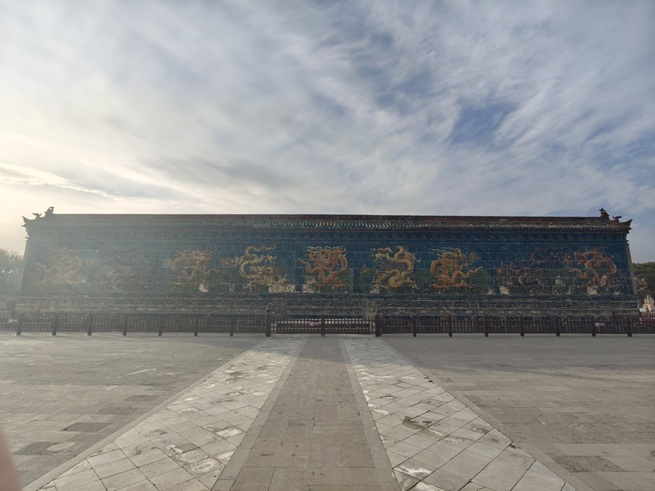

#### 细看

1. **下部**：**琉璃贴面须弥基座**，束腰部分雕刻狮、象、麒麟、鹿、飞马等动物图案。

2. **壁身**：正面雕刻**九条巨龙**翻腾于云海之中。

3. **用材**：全部壁面由 **426 块**黄、绿、白、赭、紫、蓝色**琉璃构件**拼砌而成。

4. **顶部**：**仿木构庑殿顶**，檐上勾滴、瓦垄、脊兽、戗兽俱全；正脊上雕刻行龙、莲花等图案。

> 这是琉璃照壁最容易被忽略的一点：**它的屋顶是"假的木构"**——用琉璃把真实的梁架、瓦作、脊兽全部仿制出来，等于给建筑做了一次"材质替换实验"。

5. **壁前水池**：长 35 米、宽 4.75 米，中有**双孔石桥**，四周石栏杆，望柱上雕石榴、动物等。

> 池水是**为了倒影**——龙壁 + 水面，才是完整的构图。看九龙壁要走到池对岸回望。

#### 总结

九龙壁是明洪武二十五年（1392）代王朱桂府邸的照壁，府邸明末毁于兵火，唯壁幸存。壁体长 45.5 米、高 8 米、厚 2 米，全部壁面由 426 块黄、绿、白、赭、紫、蓝琉璃构件拼砌，下部为琉璃贴面须弥基座，束腰雕狮、象、麒麟、鹿、飞马，壁身正面九条巨龙翻腾云海，顶部是**仿木构庑殿顶**，勾滴、瓦垄、脊兽、戗兽俱全，正脊另雕行龙与莲花。最容易被忽略的一点正在这个屋顶：用琉璃把一座木殿的梁架瓦作完整"抄"了一遍，等于做了一次材质替换实验。壁前水池长 35 米、宽 4.75 米，中有双孔石桥，四周石栏杆，望柱雕石榴与动物——池水是为倒影而设，看九龙壁要走到池对岸回望，龙壁加水才是完整构图。

### 3.3 善化寺

**第一批国保**，俗称南寺：唐开元年间始建，金代圆满和尚重修重建，明正统十年（1445）英宗赐名——辽金寺院里布局最完整的一处。

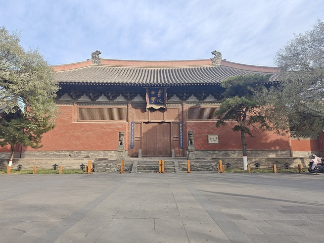

#### ① 山门（天王殿）

| 项    | 内容                                                           |
| ---- | ------------------------------------------------------------ |
| 年代   | **金代**                                                       |
| 形制   | 外观**单檐庑殿顶**，面阔五间、进深两间                                        |
| 斗拱   | **屋檐下通铺斗拱**（各间均设）                                            |
| 时代特征 | 相比唐代建筑，**阑额上新增了普拍枋**（群资料写"普牌坊"，应为"**普拍枋**"）                  |
| 殿内   | 供**四大天王**：西方广目天王、东方持国天王、南方增长天王、北方多闻天王；**明末塑像**，表现手法夸张、情绪表达直接 |

> **普拍枋**是个关键断代标志：唐构基本不用普拍枋（阑额直接压在柱头），辽金开始普遍在阑额上加一条横向扁木（普拍枋）来承托斗拱。**看到普拍枋，年代就往后推。**

#### ② 三圣殿

| 项   | 内容                                                                    |
| --- | --------------------------------------------------------------------- |
| 年代  | **金代**                                                                |
| 形制  | 面阔五间、进深四间                                                             |
| 移柱法 | 当心间柱间距 **7.68 米**——用**移柱法**把柱子挪开，换来一个超宽的开间                            |
| 斗拱  | 屋檐下有**一组最大的补间斗拱**，**出斜拱**，补间双铺作，**真假昂交替出现**                           |
| 梁架  | 用**减柱法**，中间内柱把六椽栿分为"四椽栿 + 乳栿"，佛背后还有后乳栿，共**八椽**；侧面用**移柱法**，变为"五椽 + 三椽" |
| 塑像  | 法坛供**一佛二菩萨**（华严三圣）；塑像年代有**明代说**与**金代说**，待考                            |
| 碑刻  | **朱弁碑**（见下）                                                           |

> **"真假昂交替"**：昂是斗拱中斜向伸出的构件，真昂是结构性的，假昂是装饰性的（只做出昂的形状而实际由华拱挑出）。金代大量使用**假昂**，是"结构让位于装饰"的开端——**这是判断建筑"是否开始走下坡"的一个技术指标**。

#### 朱弁碑（《大金西京大普恩寺重修大殿记》）

- **内容**：金代**朱弁**撰文，**孔固**正书，**丁暐仁**篆额，**解遵一**刊石。

- **年代**：群资料记"1176 年"；按碑文落款"**皇统三年二月丁卯**"，应为**金皇统三年（1143）**（见附录 D）。

- **作者**：朱弁（1085—1144），字少章，**徽州婺源**人（碑末自称"江东朱弁"）。南宋建炎二年（1128）出使金国被扣，**羁留云中（大同）十四年**，在善化寺（时称大普恩寺）设馆授徒，与寺僧圆满交往十四年。碑文即应圆满之请而作。

- **价值**：文章、书法、刻工俱佳，被称为"**金碑之冠**"，是研究善化寺沿革与金代大同社会的一等史料。

#### ③ 大雄宝殿

| 项     | 内容                                                                    |
| ----- | --------------------------------------------------------------------- |
| 年代    | **辽代**                                                                |
| 形制    | **单檐庑殿顶，面阔七间、进深五间**                                                   |
| 稀缺性   | **全国现存辽代木构仅 8 座**，此为其中之一                                              |
| 梁架    | **减柱法**，殿内空间极开阔                                                       |
| 屋顶    | **彻上露明造**（无天花板，梁架全部外露），正中设**平棋藻井 + 斗八藻井**                             |
| 佛坛    | **五方佛**：正中释迦牟尼，左东方药师佛、南方宝生佛，右西方阿弥陀佛、北方不空成就佛；佛两侧**迦叶、阿难**，另有两尊**胁侍菩萨** |
| 二十四诸天 | 佛教护法，**主流观点为金代塑像**，**色彩明代补过**，通高 **3.8 米**                            |

> **"彻上露明造"** 是辽金建筑常见做法：不做天花，把梁架、槎头、托脚全露出来。好处是显得高大、便于检修，坏处是易积尘、梁架受温湿度影响更直接。看的时候抬头数一数梁架的层次——**这是最便宜的"结构课"**。

#### 总结

善化寺的价值在"整组"。它始建于唐开元年间，称开元寺，五代后晋改大普恩寺，金代圆满和尚主持重修重建，明正统十年（1445）英宗赐名善化寺；一座金代山门、一座金代三圣殿、一座辽代大雄宝殿沿中轴一字排开，四百年不断档，是中国现存辽金寺院中布局最完整的一处。断代的关键细节是山门阑额上新加的**普拍枋**——唐构基本不用，辽金开始普遍加这条横向扁木承托斗拱，看见它，年代就往后推。三圣殿用移柱法把当心间柱距拉到 7.68 米，斗拱出一组最大的补间斜拱，真假昂交替，正是"结构让位于装饰"的开端；梁架用减柱法把六椽栿拆成四椽栿加乳栿，共八椽。大雄宝殿为辽构八座之一，面阔七间、进深五间，彻上露明造无天花板，正中设平棋与斗八藻井，佛坛五方佛，两侧二十四诸天通高 3.8 米、金塑明彩。殿前那通朱弁碑（1143）文章、书法、刻工俱佳，被称"金碑之冠"，作者是南宋使臣朱弁——他被扣云中十四年，就在这座寺里设馆授徒；碑文末段用铜钟款识推断寺名沿革，方法与梁思成读题记定年代如出一辙。

### 3.4 华严寺

**第一批国保**，华严宗寺院，占地 66000 平方米——上寺看体量，下寺看精品。

#### 普光明殿（新建）

| 项   | 内容                                                                                       |
| --- | ---------------------------------------------------------------------------------------- |
| 形制  | 主殿**重檐歇山顶**，前出抱厦为单檐歇山顶，四周设回廊，**副阶周匝**                                                    |
| 塑像  | 正中供**华严三圣**：**毗卢遮那佛**居中，左文殊、右普贤（辽代塑像风格）                                                  |
| 壁画  | 四周一圈绘《**善财童子五十三参**》，2009 年由中央美术学院**孙景波、王颖生**教授带领博士生 150 余人绘制，历时 3 年；颜料用**珍贵矿石颜料 + 沥粉贴金** |
| 背屏  | 背后**自在观音**壁画，仿北京**法海寺《水月观音》**                                                            |

> 这是"新塑 + 古法"的组合：**用明代法海寺的技法，画当代的壁画**。看的时候可以把它当"当代人怎么理解辽代"的一个样本。

#### 大雄宝殿（上寺主殿）

| 项   | 内容                                         |
| --- | ------------------------------------------ |
| 始建  | 辽清宁八年（1062），毁于战火                           |
| 重建  | **金天眷三年（1140）**                            |
| 朝向  | **坐西向东**                                   |
| 形制  | **单檐歇山顶，面阔九间、进深五间**                        |
| 地位  | **现存木结构建筑中规模最大的单体建筑**（辽金佛殿之最）              |
| 鸱吻  | 高 **4.5 米**，**一为明代、一为金代**，是**中国现存最大的一对鸱吻** |

**殿内三看：**

1. **平棋藻井 1024 块**，通铺殿顶，**无一雷同**。抬头看天花，是这座殿最震撼的一刻。

2. **五方佛**（明代塑像精品）：

   - 正中：释迦牟尼

   - 左侧：东方药师佛、南方宝生佛

   - 右侧：西方阿弥陀佛、北方不空成就佛

   - **中间三尊为木雕，最外侧两尊为泥塑**——材质不同，是因为明代补配时按"可及性"取材。

3. **壁画**：清光绪十一年（1885），画师**董安**依据金代遗留的一小部分**补绘**。

> 所以华严寺大雄宝殿的壁画是"**清代人临摹金代残迹**"，不能当金画看，但能看出清末画师对金代的理解。

#### 薄伽教藏殿（下寺）

| 项   | 内容                                  |
| --- | ----------------------------------- |
| 定位  | 辽代**藏经阁**（"薄伽"即薄伽梵，佛的尊号）            |
| 四辽  | **辽代地基、辽代建筑、辽代彩塑、辽代藏经柜**——四位一体，全国罕见 |
| 形制  | **单檐歇山顶，面阔五间、进深四间**                 |
| 鸱吻  | 现为**复制品**，原件在**大同市博物馆**             |

**殿内二看：**

1. **29 尊辽代泥质彩塑**

   - 辽代彩塑的精品群。

   - **合掌露齿菩萨**最具代表性——露齿而笑，在佛像造像中极为罕见（佛教造像多讲"含而不露"），被称为"**东方维纳斯**"；群资料称"全国唯二"。

> 这一尊的笑，是辽代造像"人间化"倾向的极端案例：**神也会笑出声来**。

2. **天宫楼阁（小木作藏经柜）**

   - 靠墙环殿一周，为**小木作**（按比例缩小的建筑模型）。

   - 梁思成叹为"**海内孤品**"。

   - 它把辽代建筑的**真实形制**按比例完整雕刻下来——**在辽代木构只存八座的今天，这圈柜子等于一份辽代建筑的"图纸档案"**。

#### 总结

华严寺要按三步看。第一步看朝向：全寺坐西向东，因契丹人拜日，这与汉地寺院坐北朝南的惯例截然不同——先明白"这是契丹人的寺"，后面就都顺了；它是华严宗寺院。第二步看体量：上寺大雄宝殿始建于辽清宁八年（1062），金天眷三年（1140）重建，单檐歇山顶、面阔九间进深五间，是现存木构中规模最大的单体建筑；屋顶那对鸱吻高 4.5 米，一金一明，是中国现存最大的一对；殿内平棋藻井 1024 块无一雷同，五方佛为明代精品（中间三尊木雕、外侧两尊泥塑），壁画则是清光绪十一年画师董安依金代残迹补绘，不能当金画看，却能看出清末画师对金代的理解。第三步看下寺薄伽教藏殿：辽代地基、辽代建筑、辽代彩塑、辽代藏经柜四位一体，29 尊辽塑中以合掌露齿菩萨最著名——露齿而笑在佛教造像里极罕见，是辽代造像"人间化"的极端案例；靠墙环殿一周的小木作"天宫楼阁"被梁思成叹为"海内孤品"，在辽代木构只存八座的今天，这圈柜子等于一份辽代建筑的图纸档案。

---

## 第四站：应县（净土寺到木塔）

应县是这条线上"**密度最高**"的一站：一座金代小殿（净土寺）与一座辽代巨塔（木塔）相距不到一公里，步行可达。

**先看小的，再看大的**——净土寺的九眼藻井是"精微"，木塔的 67.31 米是"宏大"。先精微后宏大，观感有落差，印象更深；反过来先看木塔，再看藻井，容易"看不进去"。

### 4.1 净土寺大雄宝殿

**金天会二年（1124）｜第六批国保**——一座三间小殿，头顶却是金代小木作的天花板级精品。

#### 细看

1. **屋顶**：四角翘檐舒展，曲线缓和优美；**绿琉璃剪边**（瓦面用灰瓦、檐口一圈用绿琉璃）是金代常见做法，等级感立刻出来。

2. **殿内清代壁画**：构图与技法有**民间传统画风**——与金代藻井形成"上下两个时代"的对照。

3. **天宫楼阁藻井（全场核心）**

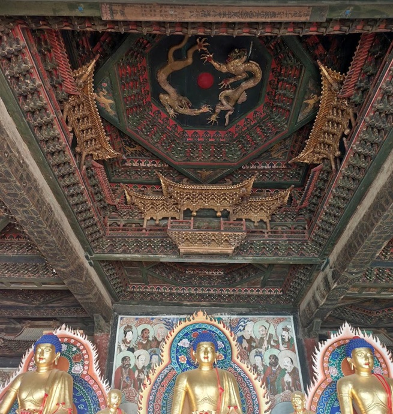

   - 顶部木雕天宫楼阁藻井，**基本为金代原物**；

   - 分作**九眼藻井**（九个藻井单元），精雕细刻，极尽华美；

   - 形式有**八角、六角、菱形**；

   - 是"**我国模仿木构建筑形式而雕刻的最为精美的小木作实物精品**"。

#### 梁思成的"应县三宝"

1933 年梁思成到应县，说应县有**三宝**：  

1. **佛宫寺释迦塔**（应县木塔）

2. **净土寺天宫楼阁藻井**

3. **净土寺山门前"披头散发"的一对石狮**

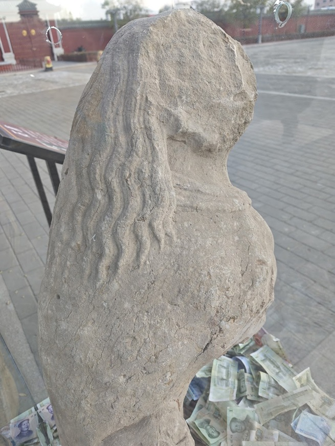

> 第三宝特别容易被忽略——那对石狮的鬃毛与须发作"披散"状，与明清石狮的卷毛程式完全不同，是**金代石雕的罕见样式**。去净土寺，别忘了回头看山门。

#### 总结

净土寺大雄宝殿建于金天会二年（1124），第六批国保，面阔进深各三间，平面近方，单檐歇山顶，四角翘檐舒展、曲线缓和，屋面灰瓦配绿琉璃剪边、戗脊有骑凤仙人，是金代小殿里的精品。核心看头顶：天宫楼阁藻井基本为金代原物，分作九眼，形式有八角、六角、菱形，精雕细刻，是我国模仿木构建筑形式雕刻得最精美的小木作实物。殿内壁画为清代作品、民间画风，正好与头顶形成"上金下清"的对照。梁思成 1933 年到应县说"应县三宝"：佛宫寺释迦塔、净土寺天宫楼阁藻井、净土寺山门前"披头散发"的一对石狮——第三宝最易错过，那对石狮鬃毛须发作披散状，与明清石狮的卷毛程式完全不同，是金代石雕的罕见样式。它离木塔不到一公里，二十分钟就够，却把"精微"这一层补上了。
  
### 4.2 应县木塔（佛宫寺释迦塔）

**辽清宁二年（1056）｜第一批国保**——高 67.31 米，世界现存最高、最古的纯木结构建筑。

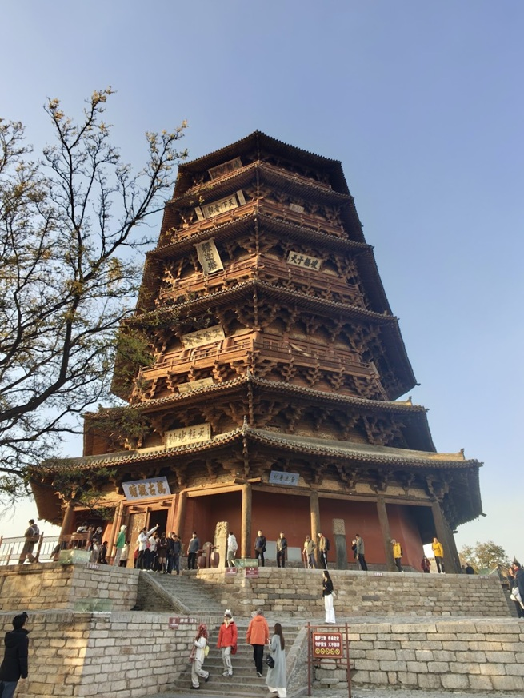

#### 数据资料

| 项    | 数据                                                 |
| ---- | -------------------------------------------------- |
| 高度   | **67.31 米**                                        |
| 底层直径 | **30.27 米**                                        |
| 木材用料 | 原木约 **7400 立方米**，实际净用约 **3000 立方米**                |
| 重量   | 约 **2600 吨**（群资料口径；另有"总重 7400 余吨"的通行说法，口径不同，见附录 D） |
| 工期   | 历时约 **140 年**（辽代始建，增修至金代完成）                        |
| 斗拱   | **54 种形制、252 组斗拱**（另有"59 种"一说）——"**斗拱博物馆**"        |
| 层数   | 外观 **5 层**，实为 **9 层**（明五暗四：五层明层 + 四个暗层）            |
| 平面   | **八边形**——中国**第一座八角形木塔**                            |
| 材料   | 主体**华北落叶松**；斗拱**榆木**                               |
| 牌匾   | 塔身悬挂 **54 块**，现存 **51 块**（丢 2 块、1 块维修）             |
| 名匾   | "**峻极神工**"——明成祖**朱棣**题；"**天下奇观**"——明武宗**朱厚照**题     |

#### 突破建塔史的三个"第一"

1. **第一次使用八边形双套筒结构**——内外两圈柱子（外柱 24 根、内柱 8 根）组成"**筒中筒**"，是现代高层筒体结构的先声。

2. **地基直径突破 30 米**（30.27 米），塔基规模空前。

3. **"十塔九歪"的主动倾斜**——相传建塔时特意向**西北**方向倾斜，借当地主导风向与自然力长期作用把塔"扶正"；今天实测塔身已**向东北倾斜**。

> 第 3 条属**讲解口径**，学界对"主动预倾"说法有争议，实际倾斜主因是二层结构被改动（见下）。听的时候当"民间智慧"记，别当定论。

#### 木塔为什么歪了？——一个人为事故

- **原状**：二层内外槽之间原有**夹泥墙**，起**斜撑**作用，是结构体系的一部分。

- **改动**：**1930 年代**（群资料记 1931 年当地县令下令；通说为 1926—1935 年间地方人士拆改）认为泥墙"不好看"，将其拆除，**改成全部格扇门板**。

- **后果**：**斜撑层被破坏**，二层刚度骤降，日积月累，木塔**严重歪斜**（二层歪斜最为明显）。

> 这是中国文物保护史上最著名的一次"**好心办坏事**"：为了"好看"，拆掉了承重构件。它也是今天"**最小干预原则**"最有力的反面教材。

#### 近千年不倒的原因

| 原因         | 机制                                                               |
| ---------- | ---------------------------------------------------------------- |
| ① **干燥少雨** | 应县气候干燥，木材不易腐朽                                                    |
| ② **用料讲究** | 华北落叶松经**反复浸泡桐油**，韧性强，防腐、防潮、防虫蛀                                   |
| ③ **结构稳定** | **双层套筒 + 叉柱造**（上层柱脚叉在下层斗拱上，逐层内收），防风抗震；**斗拱 + 全榫卯**，以"柔"耗能，减小地震冲击 |
| ④ **生物防线** | 相传**麻雁**（一种鸟）在塔上筑巢，捕食蛀虫，被称为木塔的"守护神"                              |
| ⑤ **无钉**   | 全塔**不用一颗铁钉**，全靠榫卯咬合——避免铁件锈胀劈裂木材                                  |

> 把这几条和悬空寺、佛光寺对照，会发现同一套逻辑：**干燥气候 + 桐油处理 + 柔性榫卯结构 + 生物/人为维护**。这就是"山西古建为什么能留这么多"的微观版本（宏观版见附录 A）。

#### 一层塑像与壁画

**① 释迦牟尼彩塑，高 11 米**

- 脸型丰满宽圆，神态亲切安详；

- **石绿色眉毛**犹如新月，双目微启；

- 两眉间有**白毫相**；

- 唇边有**石绿色卷曲胡须**，颜色与眉毛一致；

- 两耳垂肩，**明显戴着耳环**。

> **这是辽代契丹男子的审美**：契丹男子以**蓄须**为美，且习惯**戴耳环**。所以这尊佛像的脸，其实是一张"契丹贵族的脸"——**佛像的地方化，从长相开始**。

**② 壁画约 260 平方米**

- 大部分集中于**一层内槽墙壁**；

- 有**辽代原作**，也有历代修补重绘或覆盖重画的，基本保存完好；

- **一层内槽南北门额上绘有六个供养人：南为三女像，北为三男像**；

- 内槽上壁绘**六幅巨大佛像**，据专家考证为**建塔时的原作**。
  
#### 总结

应县木塔（佛宫寺释迦塔）建于辽清宁二年（1056），高 67.31 米，底层直径 30.27 米，外观五层实为九层（明五暗四），是中国第一座八角形木塔，底层直径 30.27 米，与比萨斜塔、埃菲尔铁塔并称"世界三大奇塔"。技术账要算清：54 种形制、252 组斗拱，"斗拱博物馆"不是虚名；内外两圈柱列（外 24 根、内 8 根）构成筒中筒，配合叉柱造逐层内收，是现代高层筒体结构的先声；主体用华北落叶松、斗拱用榆木，反复桐油浸泡，全塔不用一颗铁钉，靠榫卯咬合，地震时以柔耗能。它能近千年不倒，是干燥气候、材料处理、柔性结构与生物防线（传说麻雁捕虫）四件事同时成立。但它今天歪了，原因不是天灾：二层原有起斜撑作用的夹泥墙，1930 年代被地方人士嫌"不好看"拆改为格扇门板，刚度骤降，日积月累塔身严重倾斜——这是中国文物保护史上最著名的一次"好心办坏事"，也是"最小干预原则"最有力的反面教材。一层那尊 11 米高的释迦牟尼彩塑，石绿眉毛配石绿卷曲胡须、明显戴耳环，正是辽代契丹男子蓄须佩环的审美；内槽壁画约 260 平方米，南三女北三男共六个供养人，上壁六幅大佛据考为建塔时原作。

---

## 第五站：朔州（崇福寺）

崇福寺是金代建筑在这条线上的"**收官**"：弥陀殿（1143）与观音殿（金晚期）把"**减柱、移柱、鸳鸯拱、真假昂**"这些技术全部演示了一遍。

看完它再回看应县与大同，金代的轮廓就完整了——**大同看金代的"大"（华严寺大雄宝殿），应县看金代的"精"（净土寺藻井），朔州看金代的"巧"（弥陀殿的棂花与鸳鸯拱）**。

### 5.1 崇福寺

**第三批国保**，占地 23400 平方米，前后五进院落——现存弥陀殿、观音殿为金代遗构，其余皆明清。

#### 朝代更迭（一条清晰的时间线）

| 年代               | 事件                                             |
| ---------------- | ---------------------------------------------- |
| 唐高宗**麟德二年（665）** | 由**鄂国公尉迟敬德**奉敕监造                               |
| 辽代               | 官府占居，称**林衙署**；后改为僧舍，名**林衙院/林衙寺**               |
| 金**皇统三年（1143）**  | 金熙宗崇佛，敕命开国侯**翟昭度**主持增建**弥陀殿、观音殿**，改寺为**净土宗佛刹** |
| 金**天德二年（1150）**  | 海陵王完颜亮赐额"**崇福禅寺**"                             |
| 元、明、清            | 历代重修，始成现有规模                                    |

#### ① 金刚殿（天王殿）

- 始建于**唐代**，**清代重建**。

- 中间供**三大士**；一圈壁画为**二十四诸天**，均新绘。
  
#### ② 千佛阁

- 原名**藏经楼**，建于**明洪武年间**；因存元代御赐《**大藏尊经**》得名。

- **两层重檐歇山式**屋顶；一层屋檐做**庑门**形式，屋檐下**弱化了斗拱结构**。

- 内供**大度弥勒佛**——明代**千斤铜像**。

- 上有**三层小阁楼，高 4.5 米**；**拱眼壁有凤凰，立柱上有飞龙，凤凰在上、龙在下**——这是**唐代风格**（凤高于龙，武则天以后一度成为定制），**明代仿唐**的做法。

> 一个"**凤上龙下**"的细节，就把唐、明两代的礼制观念串起来了。这种小地方最见功夫。

#### ③ 大雄宝殿（三宝殿）

| 项   | 内容                                                                |
| --- | ----------------------------------------------------------------- |
| 年代  | **明成化年间**                                                         |
| 形制  | **单檐歇山顶，面阔五间、进深四间**；屋顶正脊较长，**坡度平缓**；有**月台**，门前有**抱鼓石**            |
| 梁架  | 次间屋顶 **8 椽**；当心间**四椽栿前移**，做成"四椽栿 + 后乳栿 + 劄牵"的形式——**明清建筑有了更多纵向连接** |
| 塑像  | **三世佛**贴金彩塑坐像；背后塑**韦驮菩萨**贴金像（明代）                                  |
| 壁画  | 东西壁各十列，共**千尊小佛**                                                  |

> **"纵向连接增多"**是明清梁架与辽金梁架的关键差别：辽金靠"减柱"做空间，明清靠"加构件"求稳定——**前者做减法，后者做加法**。

#### ④ 弥陀殿（全场核心）

**建筑**

- **金代**，**单檐歇山顶，面阔七间**。

- **前檐五间装格扇门**，上置横披棂花；**后檐明间与两梢间设板门三道**，前后可穿行，其余皆为墙壁。

- 殿身坐落在**高 2.4 米的台基**上，台前有宽敞**月台**。

- **屋顶琉璃瓦为 1980 年代重新加**：持续 **10 年**的修复工程，由**柴泽俊**先生主持。

- **斗拱**：**柱头铺作复杂、补间铺作简单**，出现"**鸳鸯拱**"（同一建筑中不同形制的拱混用）。

> 一般规律是"柱头简单、补间复杂"（如善化寺三圣殿），弥陀殿反其道而行——**这就是"鸳鸯拱"的可看之处**。

**门窗**

- 材质：**红松木**。

- 前檐进间、次间、梢间各有 **5 种**形式的窗花，共 **15 种**棂花图案；其中"**六交十二碗**"最复杂。

> 金代小木作的门窗棂花，是"**用木条画画**"。站在殿前把 15 种花样数一遍，值 20 分钟。

**殿内塑像**

- 佛坛供**西方三圣**（阿弥陀佛、观世音、大势至），身高均在 **9 米以上**。

- **四尊胁侍菩萨**塑像水平最高，高约 **4.5 米**，表情生动，姿态优美。

- **哼哈二将**：脸部很亮，**身体倾斜约 12—19 度**（前倾，使仰视者看到正面）。

- **背光**：高 **14 米**、宽 **6 米**；做法是**木骨架 → 藤条编织 → 泥做缠织 → 镂空泥塑**，镂空能**有效防虫蛀**。

> 14 米高的背光靠"藤编 + 泥塑"做轻量化，与悬空寺"脱纱佛像减重"是同一思路：**大件必须轻**。

**壁画（真正的王牌）**

- **东西两壁主体**：原各三铺巨幅**说法图**，现存**五铺**。

  - 主佛**结跏趺坐**，两侧胁侍菩萨，上方祥云飞天。

  - **菩萨一大看点：带胡须**——延续唐、辽**古相**，不是后世的柔美女相。

  - 手中各持**香炉、经卷、宝盘、珊瑚、莲花**，各不重复。

  - **火焰背光**，**铁线描**力道极强。

- **南壁西侧（王牌中的王牌）**：**千手千眼十一面观音**

  - **国内现存最高的金代千手观音壁画，高约 4.68 米**；

  - 头顶**叠五层佛面**，身后千百只手臂**如孔雀开屏**，**每掌一眼**，**密教风格**，震撼度最高；

  - 旁配**吉祥天**、**辩才天**。

#### ⑤ 观音殿

- **金代晚期**，面阔五间、进深三间，**斗拱巨大**，**单檐歇山顶**。

- 内塑"**三大士**"贴金坐像：观音居中，左右文殊、普贤。

- **梁架**：将**前槽金柱全部减去**，梁架采用**双重人字形叉手**，构件相互连接得当，**堪称我国建筑史上的典范**。

> 观音殿是"**减柱法**"的教科书案例：为了一个完整的礼佛空间，把整排金柱拿掉，再用双重叉手把荷载"抄"到两侧。**结构为了空间让步，还要保证安全**——这就是中国木构最迷人的地方。

#### 总结

崇福寺是一座院子里放了三代：唐麟德二年（665）尉迟敬德奉敕监造，辽代官府占为林衙署、后改僧舍，金皇统三年（1143）翟昭度主持增建弥陀殿与观音殿并改宗净土，天德二年（1150）海陵王赐额"崇福禅寺"；现存弥陀殿、观音殿为金代遗构，余皆明清。弥陀殿是核心：面阔七间，单檐歇山顶，台基高 2.4 米；柱头铺作复杂、补间铺作简单，出现"鸳鸯拱"，与常见的"柱头简、补间繁"正好相反；前檐五间装格扇门，棂花十五种，"六交十二碗"最复杂；殿内西方三圣身高均逾九米，四尊胁侍菩萨高约 4.5 米，哼哈二将脸部很亮、身体前倾 12—19 度以便仰视；佛像背光高 14 米宽 6 米，木骨—藤编—泥塑镂空，防虫蛀也减重。壁画是真正的王牌：东西壁原各三铺说法图，今存五铺，菩萨带胡须，延续唐辽古相而非后世柔美女相，手中香炉、经卷、宝盘、珊瑚、莲花各不重复，火焰背光铁线描力道极强；南壁西侧千手千眼十一面观音高约 4.68 米，是国内现存最高的金代千手观音壁画，头顶叠五层佛面，身后千臂如孔雀开屏、每掌一眼，密教风格，震撼度最高。观音殿为金代晚期，前槽金柱全部减去，梁架用双重人字形叉手，是减柱法的教科书案例；千佛阁"凤上龙下"的拱眼壁与立柱飞龙，则是明代仿唐的礼制表达。

---

## 第六站：太原（晋祠到山西博物院）

从金代一下跳回**北宋**，气质完全不同。

晋祠是**园林式祠庙**：前面五站看的是"结构的力度"，这里看的是"**人的表情**"——33 尊宋代侍女，各有各的心事。

山西博物院则把"**晋**"这个字的来历补齐：桐叶封弟 → 燮父改唐为晋 → 九代晋侯世系，一只**晋侯鸟尊**就是"晋"的出生证明。**一条线从建筑起，到器物与文献收。**

### 6.1 晋祠

**第一批国保**，原名唐叔虞祠，园林式祠庙建筑群——为纪念晋国首任诸侯唐叔虞而建，最少一千五百年历史。

#### 晋祠"三绝"与"三大国宝建筑"

| 三绝        | 三大国宝建筑   |
| --------- | -------- |
| **宋代侍女像** | **献殿**   |
| **难老泉**   | **鱼沼飞梁** |
| **周柏隋槐**  | **圣母殿**  |

#### ① 水镜台（入口第一眼）

| 项      | 内容                                                           |
| ------ | ------------------------------------------------------------ |
| 功能     | **戏台**（酬神演戏）                                                 |
| 修缮     | 1954 年大修                                                     |
| 形制     | 巧妙融合**楼、台、殿、阁**四种样式：**前为单檐卷棚顶，后为重檐歇山顶**                      |
| 附属     | 殿背后有一对**明万历年间铁狮子**                                           |
| 名字     | 《汉书》："**清水明镜不可以形逃**"——人世间的善恶忠奸尽人皆知；戏剧中好人坏人画上脸谱，观众一目了然，故名"水镜" |
| **扩音** | 戏台**四角埋藏两两相对的八口大瓮**，形成**空心音响**，把声音反射、共振送到台下                  |
  
> 八口大瓮是最值得记住的"古代声学设计"：**不用电，用腔体共振**。站在台下正中说一句话，能听到回声。

#### ② 金人台

- **铁属五金，金镇水**——晋祠以前常年有洪涝，故建金人台**镇水**。

- 四角铁人铸造年代：

| 方位  | 年代                                |
| --- | --------------------------------- |
| 东南角 | **1089 年**（宋元祐四年）                 |
| 东北角 | **1090 年**（现存为 **1926 年**民国十五年补铸） |
| 西南角 | **1097 年**（宋绍圣四年）                 |
| 西北角 | **1098 年**（宋元符元年）                 |

> 四尊铁人三个朝代：北宋三尊 + 民国一尊。**看铁人的"补铸"痕迹，就是看一部修缮史。**

#### ③ 献殿

| 项   | 内容                                                   |
| --- | ---------------------------------------------------- |
| 功能  | 给圣母邑姜**供奉祭品的享堂**                                     |
| 年代  | 始建于**金大定八年（1168）**，明万历年间重修，**1955 年依原样翻修**           |
| 形制  | **面阔三间、进深三间，单檐歇山顶**，出檐深远；殿顶布青瓦                       |
| 梁架  | 既省料又坚固：只在**四椽栿上放一层平梁**，上立**驼峰、蜀柱**，平梁两端用**驼峰**架在四椽栿上 |
| 观感  | **体量确为殿堂，外观又好似一座凉亭**，玲珑而稳定                           |

> 献殿是"**结构做减法**"的极致：整座殿只用了极少的梁架层次，却撑起了殿的体量。它和金代"减柱造"是同一种审美——**能省一根是一根**。

#### ④ 鱼沼飞梁

- **鱼沼**：古人以**圆形为池、方形为沼**，且水中多鱼，故名"鱼沼"。

- **飞梁**：沼上**十字形桥梁**。古人云"**飞梁石磴，陵跨水道**"，"**架虚为桥，若飞也**"，故名"飞梁"。

- **中国现存唯一的十字形桥梁**（现存桥体为北宋遗构，与圣母殿同期）。

> 十字形桥，在梁思成看来是"**世界上最早的水陆立交**"。站在桥中心，四个方向都是通路——这是宋代人对"连接"的理解。

#### ⑤ 圣母殿（晋祠主体）

| 项    | 内容                                                                      |
| ---- | ----------------------------------------------------------------------- |
| 功能   | 奉祀唐叔虞之母**邑姜**                                                           |
| 创建   | 北宋**太平兴国九年（984）**（群资料口径）；现存主体常被定为**天圣年间（1023—1032）**重建，**崇宁元年（1102）**重修 |
| 形制   | **重檐歇山顶，总高 19 米，面阔七间、进深六间**，平面近似方形                                      |
| 副阶周匝 | **中国现存古代建筑中最早的"副阶周匝"实例**（殿身四周加一圈外廊）                                     |
| 梁架   | **乳栿对六椽栿用三柱**——中国现存古建中**少有符合宋《营造法式》殿堂式构架形式的孤例**                         |
| 减柱   | **殿内无一根明柱**，只在殿身四周设廊柱与檐柱承托屋架——即"**减柱营造法**"                              |
| 侧角   | 四周 **26 根柱子皆微微内倾**，制成"**侧角**"                                           |
| 升起   | **平柱至角柱逐渐升高**，造成"**升起**"                                                |
| 效果   | 既增加造型稳固力，又使**翼角翘起**，显出曲线之美                                              |

> **"侧角 + 升起"** 是宋代木构的两大高级手法，也是最容易在现场验证的：

> - **侧角**：站在殿正面看柱子的垂直线，会发现檐柱微微向内倒（像人稍稍含胸），这叫"侧脚"，让建筑显得"稳而不僵"；

> - **升起**：从明间往角柱看，柱头一根比一根高一点，所以屋檐两端自然翘起，不需要额外做假曲线。

> **这两条，就是宋代建筑"用结构做曲线"的秘密。**

**⑥ 木雕盘龙柱**

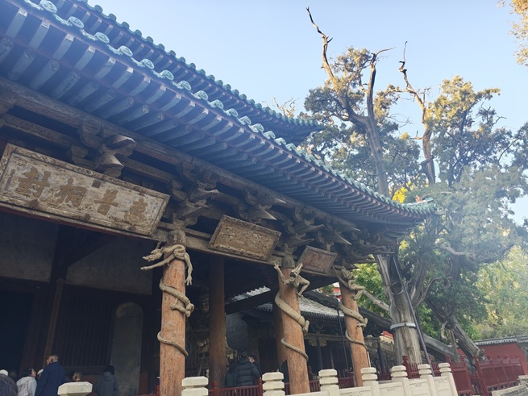

- 前檐廊柱上饰有 **8 条**蜿蜒欲动的**木雕盘龙**，是**中国现存最早的木雕盘龙柱**。

- 其中 **6 条制于宋元祐二年（1087）**，**2 条为宋崇宁元年（1102）增加**。

- 八条龙各抱一根大柱，怒目利爪，栩栩如生。

- 圣母殿正面台基两侧还有两条**无角的石雕螭首**。

#### ⑦ 宋代侍女像（三绝之首）

- 圣母殿内共 **43 尊**泥塑彩绘人像。除龛内二小像系后补外，其余多为**北宋原塑**。

- 主像**圣母邑姜**设于大殿正中神龛内：**曲膝盘坐**在饰凤头的木靠椅上，**凤冠蟒袍，霞帔珠璎**，面目端庄——显示统治者的尊贵与奢华。

- 其余 **42 尊侍从像**对称分列龛外两侧，其中：

  - **宦官像 5 尊**

  - **着男服的女官像 4 尊**

  - **侍女像 33 尊**

- 42 尊侍从"**手中各有所奉**"，为帝后服种种劳役。

- 侍女像为精品中的精品：

  - 肢体身材比例适度，服饰美观大方，衣纹明快流畅；

  - **年龄或长或少，身段或丰满或苗条，面庞或圆润或清秀，神态或幽怨或天真**；

  - 一个个性格鲜明，表情自然，高度与真人相仿，栩栩如生；

  - **完美体现了宫廷《六尚》制度**（尚宫、尚仪、尚服、尚食、尚寝、尚功——宫廷女官六大职掌）。

> **为什么这 33 尊是"三绝之首"？**

> 因为中国雕塑史上，**宋塑是"人"的觉醒**：唐塑塑神，宋塑塑人。这 33 尊侍女各有各的心事——有的得意、有的委屈、有的麻木、有的还在偷偷打量。**她们不是"侍女的类型"，是 33 个具体的人。** 站在殿前找一尊"看起来最不开心的"，你会记住整个晋祠。

#### ⑧ 周柏与难老泉

- **周柏**：周代柏树，**3000 多年**历史（与隋槐并称"周柏隋槐"）。

- **难老泉**：俗称"**南海眼**"，出自断岩层，**终年涌水，生生不息**；北齐时有人据《诗经·鲁颂》"**永锡难老**"之句命名"难老泉"；匾额为**傅山**所题。

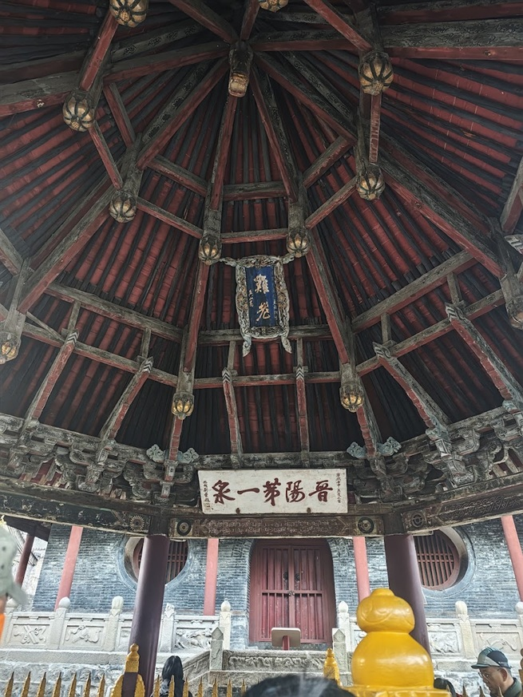

> "永锡难老"——永远赐予你不老。一眼泉，被命名成了一句祝福。**这就是晋祠的气质：把自然写成人情。**

#### ⑨ 唐碑（贞观宝翰亭）

- 亭内陈列**唐太宗李世民手书碑刻《晋祠之铭并序》**。

- 全碑 **1200 余字**，**行草**书法，骨骼雄健，笔力奇逸含蓄，有**王羲之书法神韵**，是书法艺术的珍品。

> 唐太宗存世的行书碑刻极少，这一通是**李世民唯一传世的行书碑**之一，也是晋祠"国宝"之外的另一重价值。

#### 总结

晋祠原是唐叔虞祠，园林式祠庙建筑群，最少一千五百年历史，看的就两件：三绝（宋代侍女像、难老泉、周柏隋槐）与三大国宝建筑（献殿、鱼沼飞梁、圣母殿）。圣母殿是主体，北宋创建（984 年一说，现存主体多定为天圣年间重建），重檐歇山顶、总高 19 米、面阔七间进深六间；副阶周匝是中国现存最早的实例，梁架"乳栿对六椽栿用三柱"是少有符合《营造法式》殿堂式构架的孤例；殿内无一根明柱，全赖四周廊柱檐柱承托，即减柱营造法；26 根柱子微微内倾成"侧角"，平柱至角柱逐渐升高成"升起"，凭这两手，屋檐两端自然翘起，不必另做假曲线——宋代建筑用结构做曲线的秘密就在这里。前檐八条木雕盘龙柱是中国现存最早的，六条制于宋元祐二年，两条为崇宁元年增。殿内 43 尊宋塑，圣母邑姜凤冠蟒袍居中，其余 42 尊侍从里有宦官 5、着男服女官 4、侍女 33，年龄身段面相神态各不相同，正对应宫廷《六尚》制度——唐塑塑神，宋塑塑人，这 33 尊就是"人"的觉醒。其余几处各有巧思：献殿（金大定八年）只在四椽栿上放平梁、立驼峰蜀柱，省料到极致；鱼沼飞梁是现存唯一的十字形桥；水镜台戏台四角埋八口大瓮作空心音响，不用电也有回声；金人台四尊铁人跨三个朝代（北宋三尊，东北角现存为 1926 年补铸），看补铸痕迹就是看一部修缮史；唐碑《晋祠之铭并序》是李世民传世行书，一千二百余字。

### 6.2 山西博物院·四件重器

**首批国家一级博物馆**——前面看的是"建筑怎么盖"，这里看的是"晋怎么来的"。

#### ① 晋侯鸟尊（镇馆之宝）

| 项    | 内容                                      |
| ---- | --------------------------------------- |
| 出土时间 | **2000 年**                              |
| 出土地点 | 山西**曲沃县北赵村**晋侯墓地 **114 号墓**             |
| 年代   | **西周**                                  |
| 尺寸   | 高 **39 厘米**，长 **30.5 厘米**，宽 **17.5 厘米** |

**造型**

- 主体为**伫立回首的凤鸟**：凤鸟头微昂，圆睛凝视，**高冠直立**。

- 禽体丰满，**两翼上卷**；鸟背依形设盖，**盖钮为小鸟形**，与凤鸟对望。

- 双腿粗壮，爪尖略蜷。

- **凤尾下有一象首**，象鼻内卷上扬，与凤鸟双腿形成**稳定的三点支撑**。

> 这个"三点支撑"是鸟尊最精妙的设计：**一只鸟，靠一条象鼻站住了**。功能与造型在此完全合一。

**纹饰**

- 颈部、前腹、背部及器盖：**羽片纹**

- 翅膀及腿：**云纹**

- 器盖与翅膀之间：**雷纹为底**，装饰**立羽纹**

- 尾部：**羽翎纹**

**铭文**

- 器盖内壁与器腹内底部有相同的**九字铭文**："**晋侯作向太室宝尊彝**"。

- 大意：晋侯（**燮父**）作此青铜器，供奉于太室（晋侯宗庙），为祭祀礼器。

**出土与三次修复（一段国宝抢救史）**

| 阶段      | 经过                                                                       |
| ------- | ------------------------------------------------------------------------ |
| 1998    | 114 号墓被盗墓分子**炸开**                                                        |
| 2000 年底 | 北大考古队抢救性发掘清理时，鸟尊**已被炸成 100 多片**碎片                                        |
| 第一次     | 碎片整体提取，当晚运往**北京大学**，初步修复。**象鼻中间关键一段缺失**，无法判断外翻还是内卷，散落的象鼻前端**未能接上**       |
| 第二次     | **2002 年**在上海博物馆展出期间，修复专家多方研究，最终确定为**内卷**，用**环氧树脂**做出匹配的素面象鼻             |
| 第三次     | **2018 年**北大清理当年 114 号墓青铜碎片时，发现**疑似鸟尊尾部残片**，比对证实；**2019 年**在山西博物院完成第三次修复 |

- 现陈列于《**晋国霸业**》展厅，为山西博物院"**镇馆之宝**"。

**墓主与考古意义**

- 114 号墓一般认为是**首位晋侯燮父**（改"唐"为"晋"的那一位）的墓葬。

- 晋侯墓地位于**北赵村遗址**核心地带：

  - **1991 年**遗址多处被盗，**1992 年**开始保护性发掘；

  - 至 **1994 年**共进行**五次**大规模发掘；

  - **1998 年**再次发生盗墓案；

  - **2000 年 10 月—2001 年 1 月**进行**第六次**发掘，发现 **9 组 19 座**晋侯及其夫人墓葬，另有对应车马坑。

- 出土大批铸有晋侯名号的青铜器，考古学家排列出**从燮父到晋文侯共九代晋侯的清晰世序**，**澄清了晋国始封地问题**，弥补了晋国早期编年与史实的空白。

- 晋侯墓地考古被评为"**20 世纪中国百项考古重大发现**"之一。

> **为什么一只鸟这么重要**：它把"桐叶封弟—燮父改唐为晋—九代晋侯世系"这条**只存在于文献里的线索**，变成了可以拿在手上的实物。**这是"晋"这个字的出生证明。**

---

#### ② 北齐娄睿墓《鞍马出行图》

| 项    | 内容                                     |
| ---- | -------------------------------------- |
| 出土时间 | **1979 年**（发掘持续至 1981 年）               |
| 出土地点 | 太原**王郭村**                              |
| 年代   | **北齐**                                 |
| 墓主   | **娄睿**（北齐外戚、重臣，封东安王）                   |
| 规模   | 壁画 **400 余平方米**，绘马 **200 余匹**，**无一雷同** |

**壁画三部分**

1. **鞍马导引图（前）**

   - 导骑二人。前者骑**枣红色鞍马**，安详凝视，纵辔缓行；

   - 后者**勒马回首**，马头高昂，前腿止步，**重心落于左后腿**，尾巴高高扬起，**粪便颗颗落下**。

> 这个细节是北齐壁画的"签名"：**连马粪都画出来了**。它说明画家不是在画"马的图式"，而是在画**他亲眼看见的一匹具体的马**。

2. **鞍马游骑图（中）**

   - 共**八人三马**。马均体态丰满，络头齐全，鞍靴俱备，**马鞍下铺有障泥**，佩带马镫。

   - 技法：**单层墨线勾画 + 平涂浓淡色彩 + 明暗映衬**，表现马的健壮体型，**颇有立体感**；尤其**马的眼神**处理恰到好处。

3. **鞍马导引图（后）**

   - 导骑二人。前者**策马扬鞭**，全神注意前方；

   - 后者的坐骑枣红马**猛然受惊而后缩**：马头高扬、前蹄飞跃、后腿下蹲，骑者**躬身俯伏在马背**，双手紧勒缰绳，脚踩马镫。

> **看点在"动态"** ：北齐壁画最厉害的是"**瞬间捕捉**"——惊马、回首、扬鞭，都是运动中的一帧。这种能力，要到一千多年后的摄影术才被普及。

> 娄睿墓壁画与**太原徐显秀墓壁画**并称北朝壁画双璧，是研究北齐绘画（尤其是杨子华画风）的第一等材料。

---

#### ③ 龙形觥

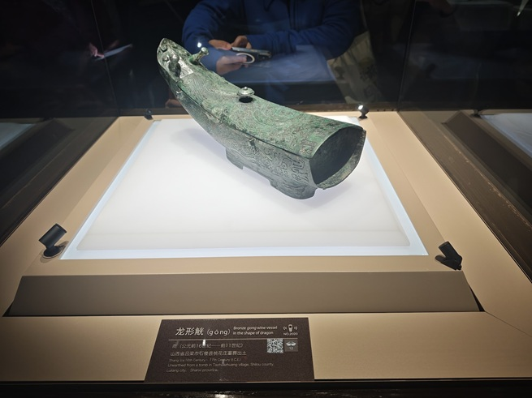

| 项    | 内容                                                 |
| ---- | -------------------------------------------------- |
| 出土时间 | **1959 年**                                         |
| 出土地点 | 山西**石楼县桃花者村**                                      |
| 年代   | **商代**（晚期）                                         |
| 尺寸   | 高 **19 cm**，长 **43 cm**，宽 **13.4 cm**，重 **8.6 公斤** |

**造型**

- 长腹弧鼓，**后端截平**；背部为弧曲形长盖，内有**横榫**与器腹扣合；盖中央有**蘑菇形钮**。

- 器身口沿外附有**两对贯耳**，用来**把龙形觥吊起加热酒**；另一端**没有封口**，用来**散水蒸气**。

- 底部有长方形**矮圈足**，放置平稳。

**纹饰**

- 盖面饰**龙纹**，与器物前端的**龙头**相衔接，两侧衬以**漩涡纹**和**云纹**；

- 器身两侧有**夔龙纹**和**鼍（tuó，即扬子鳄）纹**——这是**目前为止商周青铜器上的孤例**。

**出土过程与"鬼方"猜想**

- 1959 年，桃花者村农民种地时发现一座墓葬，出土 **16 件**青铜礼器（鼎、簋、斝、盘、壶、卣、爵等），另有玉器、铜兵器和大量**海贝**，表明这是**殷商时代的高等级墓**。

- 墓中还出土**金器**和几件**不同于殷墟风格**的青铜器，表明这是一个**与商文化密切但又不同于商的方国**。

  - "**方国**"即少数民族建立的氏族部落，与商王朝**时战时和**。

- 龙形觥出土地点推测可能是商代"**鬼方**"所在地。《周易》载："**高宗伐鬼方，三年克之**"——商王武丁征讨鬼方，打了三年才打赢。

- 因此，龙形觥**不是中原文化的器型**，很可能是一件**鬼方贵族的酒器**。

> **一句话价值**：它是"**商朝地图之外**"的一件青铜器——证明在殷墟的礼制圈之外，还有另一个会喝酒、会铸铜、会和商王朝打三年仗的政权。

---

#### ④ 彩绘蟠龙纹陶盘

| 项    | 内容                                                   |
| ---- | ---------------------------------------------------- |
| 出土时间 | **1980 年**                                           |
| 出土地点 | 山西**襄汾陶寺遗址 第 3072 号墓**                               |
| 年代   | **新石器时代晚期（龙山文化）**                                    |
| 尺寸   | 高 **9 cm**（另有 8.8 cm 数据），直径 **40.7 cm**，深 **7.8 cm** |

**造型与纹饰**

- **褐色泥质陶**，内壁大面积**涂黑**，再以**红色颜料**绘出**蟠龙纹**。

- 蟠龙**头有两角，口中有两排锯齿**，**衔着一根枝杈状物体**，**尾部模糊不清**，身上呈现**两排鳞纹**。

**出土背景**

- 出土于陶寺遗址的"**王族**"墓葬区。**四个墓葬里各出土了一件**，内壁的蟠龙纹**在细节上各有不同**。

- 因是彩绘，历经漫长岁月大多局部脱落，**这一件上的蟠龙纹保存最清晰、完整**。

**陶寺遗址**

- 发现于 **1958 年**；**1978—1985 年**进行第一阶段大规模发掘，主要发掘**生活区与墓葬区**；

- 上世纪末至今又经多次勘探发掘，发现**宫城、仓库、手工作坊区、天坛、地坛、观象台**等遗址。

- 考古专家认为陶寺是**史前古城**，**有可能是尧舜时代的都城**，活跃于距今 **4300—3900 年**；之后被废弃，其衰落可能与北面的**石峁文化**有关。

> **为什么这只盘子重要**：龙纹、朱绘、王族墓、观象台——**"最早的中国"的几个要素，在陶寺这个盘子上第一次凑到一起**。它比商周的青铜龙早了一千多年。

#### 总结

省博是整条线的落点：前面看的都是"建筑怎么盖"，这里看的是"晋怎么来的"。馆的前身是 1919 年的山西教育图书博物馆，新馆 2005 年开放，馆藏 65 万余件、一级文物 1650 余件；建筑外形如斗似鼎、四翼舒展，取自《诗经》"如鸟斯革，如翚斯飞"，拿过鲁班奖。四件重器各有分量：晋侯鸟尊（西周，高 39 厘米）以伫立回首的凤鸟为主体，鸟背设盖、盖钮为小鸟与凤鸟对望，凤尾下有一象首与双腿形成三点支撑，盖内九字铭文"晋侯作向太室宝尊彝"，墓主一般认为是首位晋侯燮父——它把"桐叶封弟—燮父改唐为晋—九代晋侯世系"这条只存在于文献里的线索，变成了可以拿在手上的实物；1998 年墓被盗墓者炸开，鸟尊碎成百余片，历经 2000 年北大初修、2002 年上海确定象鼻内卷、2019 年第三次修复，才成今天的样子。北齐娄睿墓《鞍马出行图》最厉害的是瞬间捕捉——惊马、回首、扬鞭，连马粪都画了出来，说明画家画的是亲眼见过的一匹具体的马；全墓四百余平方米壁画绘马二百余匹无一雷同。龙形觥（商代，石楼桃花者村）两侧夔龙纹与鼍纹是商周青铜器上的孤例，出土地推测为商代鬼方，《周易》"高宗伐鬼方，三年克之"，它不是中原器型，是"商朝地图之外"的一件酒器。彩绘蟠龙纹陶盘（陶寺 3072 号墓，龙山文化）朱绘蟠龙衔枝、身有两排鳞纹，同出四墓各一件而细节不同；陶寺有可能是尧舜时代的都城——龙纹、朱绘、王族墓、观象台，"最早的中国"的几个要素在这个盘子上第一次凑到一起。

---

## 附：参观后记

1. **看古建，先看"结构"，再看"装饰"**。斗拱、梁架、减柱、侧角升起——这些才是中国建筑真正的"语言"；彩塑壁画是这套语言上的"诗"。

2. **每一座幸存者，都是"被忽略"的受益者**。南禅寺因为是村庙、佛光寺因为太远、应县木塔因为太偏——**偏僻是它们活下来的原因**，也是我们今天还能看到唐代的原因。

3. **文物最大的敌人不是时间，是"我觉得这样更好看"**。应县木塔的夹泥墙、佛光寺的龙袍、清末重绘的壁画，都在提醒这一点。

---

以上是找AI协助整理的资料，此趟人文团的行程总体而言非常开心，某种程度上颠覆了我对旅行团的刻板印象，已经不是我刚毕业参加的那种形式了。团里18个人，3男15女，没想到我居然是年纪最小的。

宾馆拼房同住的湛江大哥，爱好摄影徒步和意见发表，大巴上同排同侧坐的美国回来的大姐，很博学并爱好各种艺术作品，在加上合伙吃大餐的四个姐姐，有贵州干练飒爽喜欢徒步和solo trip的，有园林专业背景好奇一切的，有川渝地区有话直说善于吐槽的，有黑龙江早上不忘健身并静静随队游览的，七个人来自不同地方，都是独自出行，居然恰好可以吃到一起，有玩笑式的小火花，总体气氛很融洽，可惜时间总是有限的，团散之后，大家大概也就永别了。

这趟除了古建知识和人文体验，我从其他人身上也看到了一些可经验性的东西，够我思索思索了。